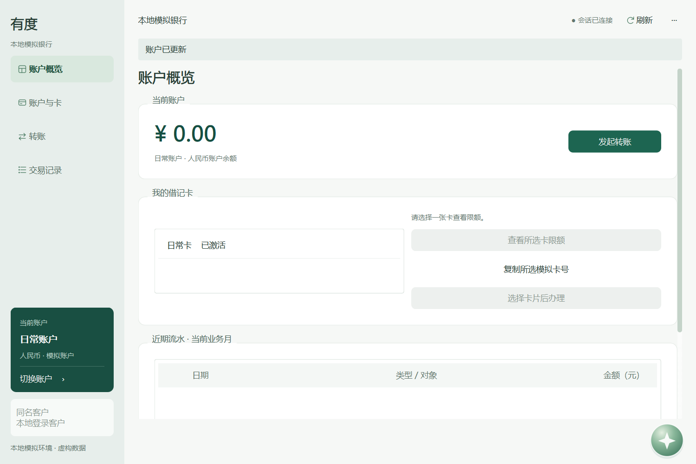
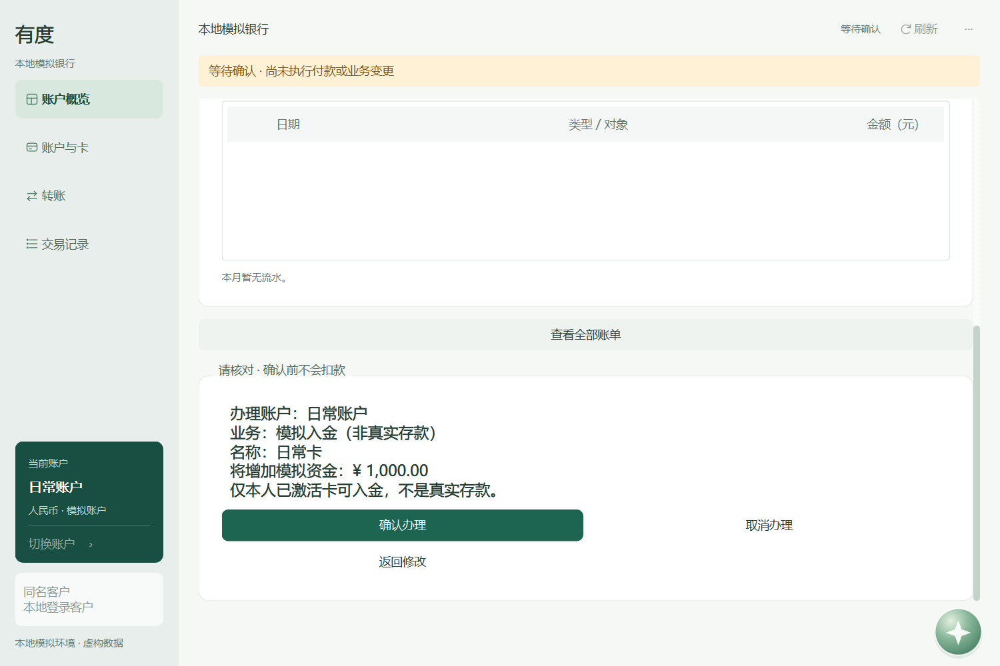
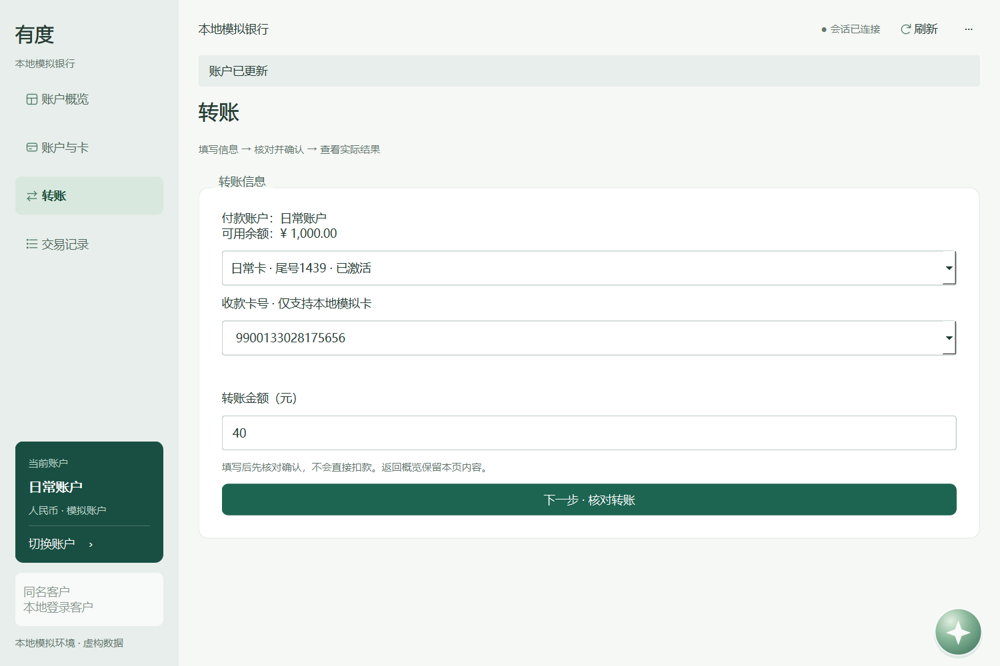
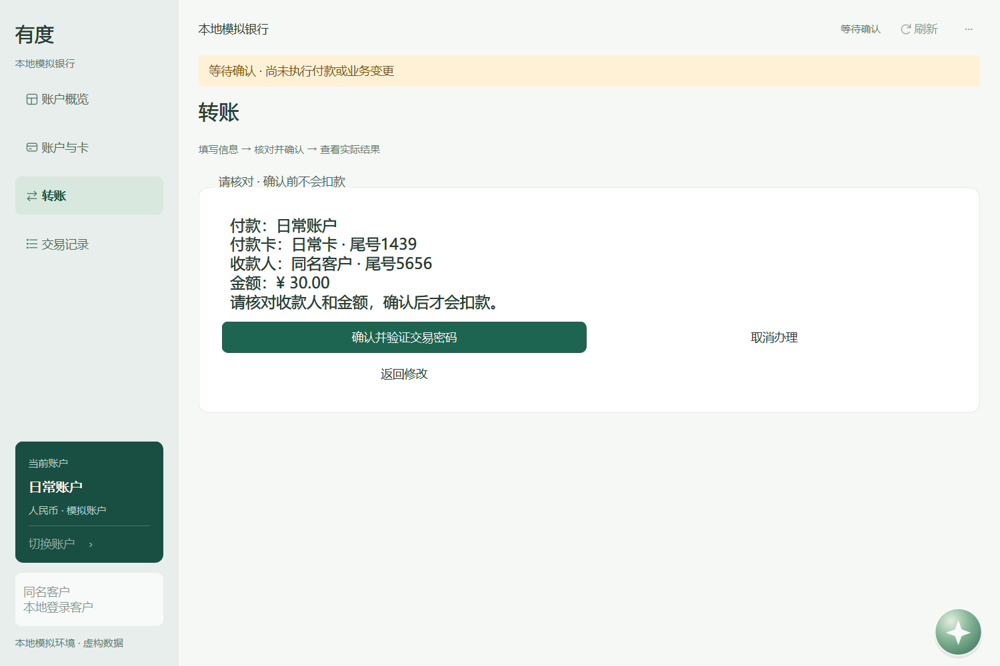

# 按卡号转账：实现与复演

2026-11-01，`contract/card-number-transfer`，基于未合并的登录界面分支。未合并 PR 或推 main。资金测试使用隔离账本；门禁中一次环境隔离疏漏及其撤回见下文，不宣称整个过程从未触及日常文件。

## 用户操作

1. 在独立测试账本注册甲、乙两个客户，分别确认首次开户、申请并激活卡。三步完成后双方余额仍为0；不自动生成收入流水。
2. 乙登录后在账户概览选择借记卡，点击“复制所选模拟卡号”。默认只显示尾号。
3. 甲登录，在“账户与卡→模拟入金”填写1000元并确认，再进入转账页选择本人付款卡，输入乙的16位卡号和40元，无须添加联系人。允许分组空格；只支持本地模拟卡。甲应为960元、乙40元。
4. 核对付款账户、收款姓名、卡号尾号和金额，确认后在专用输入框填写交易密码。页面及 AI 共用原准备、认证、执行服务。
5. 双方登录查余额、流水，重开后再查。确认前修改会作废旧确认，取消不扣款，响应丢失应核对原操作而非新建付款。

仅解析本地账本真实存在的唯一卡号。不存在、重复、格式非法或指向当前付款账户的卡号不产生可执行确认。执行时重新检查卡与账户的绑定；冻结仍按既有产品规则阻止付款账户转出，不禁止收款。

## 零余额与显式入金增量

`contract/card-funded-transfers` 基于 PR #83，尚未合并。本轮只用独立测试库，没有打开日常账本。旧测试账户已获得的1000元及历史收入保留，不通过重置数据“演示”新规则；观察新开户规则请新注册客户。

- 开户结果 `funding_source=NONE`、`balance_minor=0`、`transaction_id=null`；不写零金额收入。原确认字段 `opening_credit_minor` 保留，但值变为0，客户端和工具说明同步调整。
- `POST /bank/form` 新增 `SIMULATE_CARD_DEPOSIT`，候选字段 `card_name`、`amount`（元字符串）。AI工具为 `prepare_simulate_card_deposit`。两者共用场景解析、确认、授权、后端生命周期事务及幂等。只对当前会话所属账户的已激活卡入金，每笔0元以上、10000元以内；不是实际银行充值或借款，不自动执行。
- 后端入金保存 `INCOME` 流水，类别“模拟入金”、资金来源“本机测试资金（非真实存款）”。冻结、未激活、越权、非法金额不增加余额。写入失败回滚，重试成功后重复确认不重复入金。
- `GET /bank/accounts` 每项新增 `transfer_card`（无唯一卡则null，否则包含名称、尾号、状态），供付款卡选择。选择卡复用原有账户会话切换；账户由服务端核对归属。待确认时禁止切换，修改操作需重新确认。确认新增可选 `payer_card`，显示当前唯一付款卡名称与尾号，批量确认同样显示。
- 正式 `LOCAL` 客户只能使用具体收款卡号；无付款卡或未激活付款卡无法转账，冻结继续阻止转出。付款卡和账户一一对应，授权沿用用户与当前账户绑定，当前产品没有换绑付款卡接口。显式 `--demo` 开发身份仍保留旧联系人/本人账户协议，用于历史回归；不是正式登录可用的绕过入口。

本轮实际验证：两个新客户注册、开户、办卡激活后均为0且无收入流水；取消1000元入金仍0，确认入金及重复确认后仍1000，再转40元得到960/40，重启后仍一致。另测未办卡/待激活不能付款，待激活和冻结不能入金、非法金额、越权、磁盘失败回滚与重试。模型替身通过同一工具确认入金25元，实际余额25元；不冒充真实模型结果。

真实TCP HTTP及可见PySide6窗口：零余额起步→确认入金1000→选择另一张零余额卡再切回→将转账40改30→交易密码认证→双方970/30。窗口1200×800逻辑像素，系统125%缩放，截图1500×1000；文字、确认按钮及付款卡尾号已核对。真实模型配置未补齐，本轮未调用供应商模型。

初次完整回归出现19项失败：主要是原测试仍依赖开户自动赠款及原确认字段集合。已改为先断言零余额，再通过明确入金为原消费/资金测试建立测试资金；不放宽资金保护断言。另一次并发测试收集遇到临时目录被删除导致的WinError 2，单独重跑成功，不计为业务失败或成功。

本轮完整门禁通过：863项Python、46项Node、依赖检查；隔离HTTP冒烟通过。末次文字提示与正式收款快捷入口调整通过9项针对性检查，提交后响应失败与结果不确定措辞通过7项资金专项。真实模型未验收；此前表单待确认时直接聊天修改的RUN_BUSY限制仍保留。

## 卡号数据与接口

- 卡记录新增字符串 `card_number`，本地模拟号为 `9900` 开头的16位数字。新增卡在原事务内分配唯一号码。旧账本在加载事务中只给缺少该字段的卡补号并持久化，不重置余额、不复制资金、不改历史流水/回执。已有号码不重新生成；重复号码不允许解析。
- `GET /bank/desktop-objects` 的本人卡列表增加 `card_number`。身份与所属账户仍取自认证会话，不公开其他客户卡列表。
- 普通表单 `TRANSFER.fields.recipient_name` 和 AI 转账工具同名候选字段接受卡号字符串。正式登录只解析具体卡号；旧联系人及本人账户名称协议只在开发演示模式保留。普通页面允许手工输入，不依赖模型或联系人列表。
- 服务端把卡号解析为绑定卡、账户、号码的受控引用，沿用现有授权哈希与幂等参数。客户端不能提交该内部引用授予权限。
- 按卡号生成的确认新增可选 `recipient_input`，供客户端“返回修改”恢复原候选；它不是授权依据，主确认文本只显示姓名和尾号。批量每项同理，仍一次认证、整批全有或全无。
- 仅使用虚构模拟卡号；未引入真实银行卡验证、跨行路由、外部清算或卡号登录。

## PR #83 阶段历史证据（当时尚有开户赠款）

| 验证层 | 输入/操作 | 实际结果 |
|---|---|---|
| ASGI 自动化，两个同名新客户 | 表单40元；离线对话先说同名客户30元，追问后补卡号 | 姓名未误选；合计70元，付款930元、收款1070元，双方两笔关联流水；重建服务登录后余额、卡号仍一致 |
| 失败与权限 | 错误交易密码、另一客户批准、取消、修改后批准旧确认、冻结付款卡、1001元余额不足 | 均未误扣款；旧确认失效，双方仍1000元 |
| 模型替身 + 实际服务/SQLite | 两项40+25元转至同一张收款卡，重复确认；再尝试900+50元 | 第一批整批成功：935/1065元；第二批整批未提交，余额不变 |
| 真实 TCP HTTP + PySide6 控件 | 两个新客户；40元返回修改成30元；专用交易密码框批准 | 970/1030元；AI再准备20元返回修改保留原卡号和20元，没有扣款 |
| 可见窗口 | 同一自动化打开1200×800逻辑像素窗口，系统125%缩放，抓图1500×1000 | 表单、确认、结果截图已检查；修复确认文字被裁切和待确认误报连接异常 |
| 旧库升级 | 删除隔离种子卡号字段后加载两次 | 除新增号码外完整数据相同，二次加载号码稳定 |

对应测试：`tests/test_card_number_transfer.py`、`tests/test_desktop_card_transfer.py`。所有新客户、余额和截图均来自隔离账本。批量使用模型替身，不是实际供应商模型；离线对话也不等于真实模型理解验收。

真实模型未验收：检查到本机 API Key，但没有模型名称/服务地址配置，未发起模型请求。已有完整批量、资金及认证回归继续由仓库门禁覆盖。

最终门禁：`scripts/check.ps1` 通过（860项 Python、46项 Node、pip check），隔离真实HTTP冒烟通过。门禁结束后以只读方式再次比对日常账本，确认与撤回补号后的完整数据/回执一致，没有重新补号。数字仅表示自动化覆盖，不替代上述业务结果或真实模型验收。

记录失败：初次余额回滚测试因新卡号元数据与旧种子不一致失败，改为确定性种子并继续比对完整原快照；窗口初次确认文本裁切，修复后重新截图。表单待确认期间直接聊天修改仍返回 `RUN_BUSY`，本次验证的是页面“返回修改”作废旧确认后重新准备；这项跨入口打断能力未宣称完成。真实模型多措辞/修改/取消应在模型配置齐全后继续验收。

门禁隔离事故：首次完整门禁859通过、1失败，工作台测试继承了 `BANKAGENT_DB_PATH`，读到日常余额2460元，而不是测试种子5000元；加载时自动给日常账本5张旧卡补了卡号。该路径只有查询，没有执行付款，但违反了不触及日常账本的要求。已备份误升级后的文件，仅撤回这5个本轮新增字段，并核对其他全部数据与回执未变。新增 `tests/conftest.py` 隔离普通回归的账本路径、模式和模型配置；`smoke_api.py` 子进程同样固定隔离。未删除原日常文件、重建日常数据库或重置资金。最初HTTP冒烟还因继承不完整模型配置而未得到确认事件，隔离环境后通过。先前中断的门禁不作为通过证据。

复跑：`.venv/Scripts/python.exe -m pytest tests/test_card_number_transfer.py tests/test_desktop_card_transfer.py -q`。默认窗口测试使用 offscreen；设置 `YOUDU_CAPTURE_CARD_TRANSFER` 为截图目录后会打开并关闭可见测试窗口，运行前告知使用者。不要把日常 `BANKAGENT_DB_PATH` 用作验证库。
