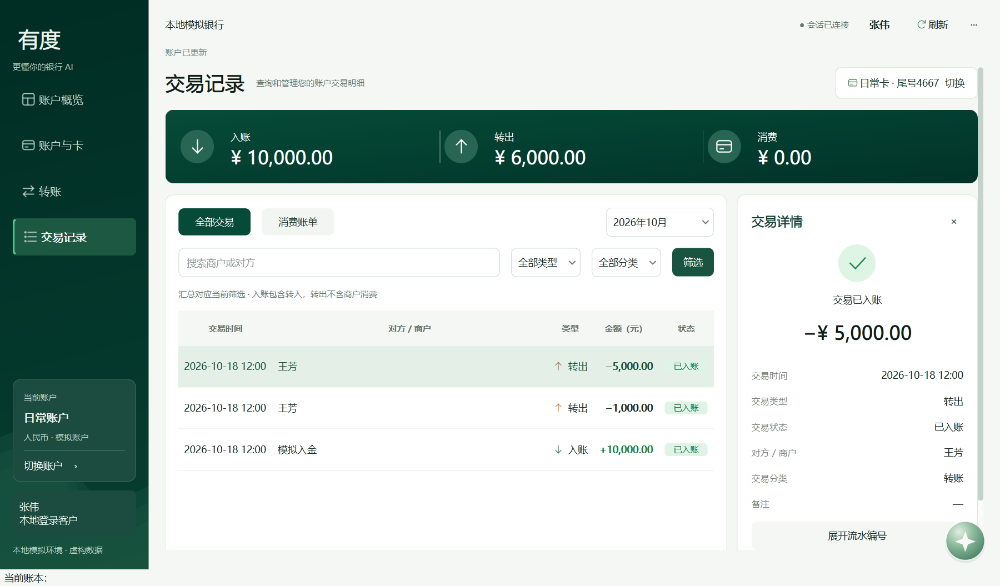
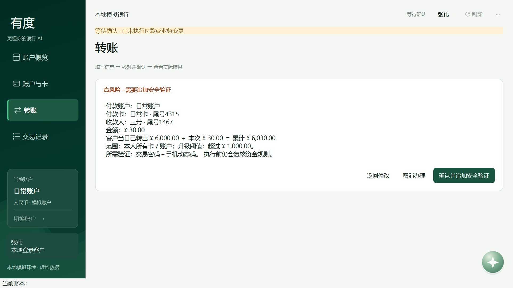

# 提交前核对 · 2026-11-01

本轮分支 `feat/submission-interface-polish`，起点 `6ba8ec1`（#89）。保留 PySide6、原EXE、原账本绑定与全部已有凭据；没有修改资金后端、认证接口、数据结构或日常账本。#76–#89为开放依赖链，未擅自合并。此版本适合本地演示和代码审查；正式参赛材料仍有下列缺口。

## 界面交付

参考图的深绿侧栏、汇总条、左侧筛选列表和右侧详情已接真实账单。新增月份快捷选择、卡片/账户切换入口、状态标签、原生线条图标；统一按钮、边框、留白。列表键盘选择也会更新详情。清除/筛选/加载失败不保留旧交易详情，空结果明确提示。小窗口将详情放到列表下方，页面可滚动。

收入、转出和消费独立统计。参考图上的付款卡字段没有直接硬套：历史流水接口不提供可靠的历史付款卡字段，不能拿当前选中卡冒充历史卡。编号保留在折叠区域。不增加没有真实能力的通知入口或伪造示例流水。

已修复的小问题：下拉箭头缺失、状态标签裁字、右上账单切换菜单错误锚点、确认按钮受全局字体增大影响而重叠、正式登录“更多”提示仍写演示重连。README当前能力与历史能力已分开，复演指南不再把自动张伟/开户赠款作为正式流程。

## 本轮证据

| 层级 | 操作与实际结果 | 证据 |
|---|---|---|
| 真实TCP HTTP | 两个新注册客户，显式入金10000；1000普通认证、5000追加TOTP后转出；付款4000，收款6000；取消30元后仍4000 | `scripts/audit_submission.py`，下方窗口记录 |
| 真实Windows窗口 | 125%：1440×844逻辑像素；150%：1283×720（屏幕边界限制）；另测1040×720。月份/重置/搜索空结果/行详情/普通确认取消 | [125%记录](evidence/submission-polish-20261101/125-ready/record.json)、[150%记录](evidence/submission-polish-20261101/150-ready/record.json) |
| 真实模型＋TCP HTTP＋离屏控件 | “我现在能用的钱还有多少？”→4000；“看看这月给王芳的转账，一共花了多少？”→两笔6000；按卡号准备40→待确认；“先取消这笔，不要扣钱”→取消，余额4000 | [完整公开结果](evidence/submission-model-20261101/record.json) |
| 自动化风险回归 | 原有本地登录/卡号转账/MFA/批量用例继续覆盖重启、跨客户、冻结、错误码锁定、批量失败、重复确认和响应丢失；不是本轮人工逐项点按 | `tests/test_local_login.py`、`test_card_number_transfer.py`、`test_customer_mfa.py`、`test_batch_transfer.py` |
| 新界面针对性 | 月份切换无记录、重置恢复、键盘选行详情、转出/消费口径、读取失败清空；助手完整确认/修改/取消 | `tests/test_ledger_page.py`、`test_assistant_space.py`：3项通过 |

原生窗口测试使用离线规则和真实模拟银行，不冒称真实模型窗口联合验收。TOTP由运行时生成的测试验证器提供，不是人工手机扫码。测试截图仅包含虚构账号及模拟卡尾号；未保存密码/密钥/二维码。

## 失败与限制如实保留

- 首轮完整门禁：869通过、1失败。新增全局字体使1040×720助手确认按钮与说明区重叠。将新品牌字号限定于侧栏，恢复通用字号后针对性通过；未放宽原布局断言。全量复跑结果见下方。
- 模型余额回答与业务余额卡仍有重复；转账汇总虽然正确为6000元，附带结果卡仍写“已查询3笔流水；消费合计0”，范围比用户问题宽。记录保留，后续应把结果卡聚焦到查询条件，不把这项计为完美体验。
- 窗口脚本有退出阶段 `can't open file for write !` 诊断；截图、HTTP断言和报告均保存，命令退出0。未定位其来源，不宣称系统日志完全无警告。
- 原生紧凑截图发现列表随上下布局切换被裁切，原因是父页面固定高度未随布局变化重算；新增布局变化通知和表格边界断言后修复，保留旧截图 `evidence/submission-polish-20261101/150-release/ledger-compact.png`。新截图包含滚动后的详情。`scripts/check.ps1` 在该项修复前也曾通过，故不以门禁替代实际窗口核对。
- 150%或紧凑窗口需要滚动查看全部详情，不等于参考图在任意尺寸下逐像素一致。

## 提交仍缺什么

| 项目 | 当前判断 / 下一步 |
|---|---|
| 本地核心演示 | 可按[当前复演指南](复演指南.md)运行；最终门禁结果在本节后记录 |
| 手机验证器 | 服务端及桌面自动化已验证；真人手机扫码联调未验收，遗失恢复/换绑未实现，不能假装已具备 |
| 模型体验 | 本轮4种请求得到上述实际结果，无泛化成功率承诺；结果卡聚焦仍可完善 |
| 理财推荐 | 按用户决定暂缓，不能在比赛材料中标为已完成 |
| 分发 | EXE依赖项目和Python环境；独立签名安装包、全新电脑安装及macOS发布未完成 |
| 演示材料 | PPT仍是旧版本；建议按下列提纲改稿并录屏。比赛官方格式/时长/截止日期需另行核对，未声称正式材料全部满足 |
| Git | 最新功能尚在堆叠PR，需用户审查后再合并；当前分支可复演，main不能代表最新产品 |

## 当前能力演讲提纲

1. 问题：自然语言与普通页面容易出现数据不一致、授权边界不清和执行结果无法复查。
2. 价值：在本地模拟银行中让模型规划、后端掌握资金与权限，读写任务可确认、可取消、可核对。
3. 演示：注册/卡号准备→普通1000元→累计升级追加认证→双方流水→AI查6000元→取消新付款→重开查原结果。
4. 架构：PySide6→HTTP会话→共用准备/认证/业务服务→SQLite；Agent不能决定认证成功，不能绕过冻结。
5. 证据与边界：展示真实窗口和实际余额，区分模型/HTTP/自动化；明确模拟资金、理财暂缓、恢复/安装包未完成。开源与VitaBench启发见架构说明，不声称通过官方基准。

## 最终门禁

代码版本 `1dffb2b77d9b59032602067a8a45c2cc321bd502`：`scripts/check.ps1` 通过，870项Python（150.86秒）、46项Node、pip check通过；提示性扫描仅为原说明与测试占位符，无本轮新增真实凭据。HTTP smoke通过账单、追问、确认、转账、重放、余额、重置；该HTTP检查在最后纯布局修复前运行，布局修复未改API或后端。125%/150%最终截图对应最终布局代码。真实模型记录在最后布局修正前生成，模型和业务实现未改；未机械重复供应商请求。
