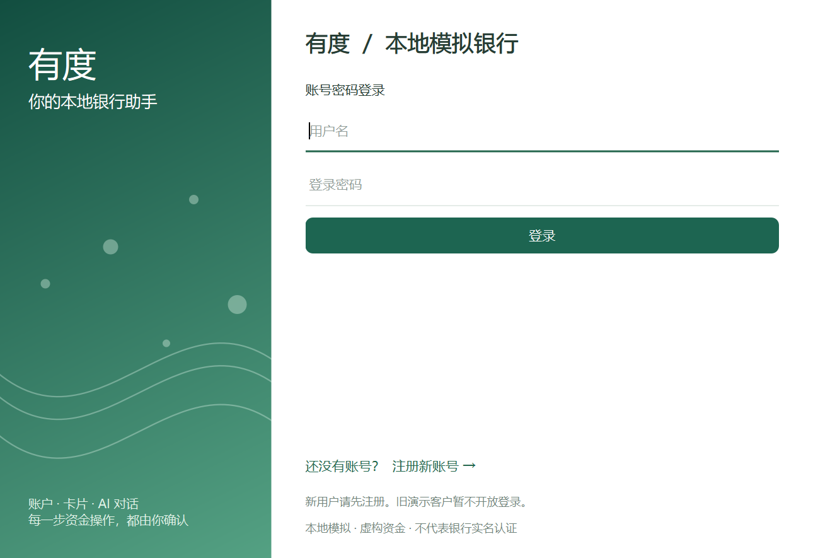
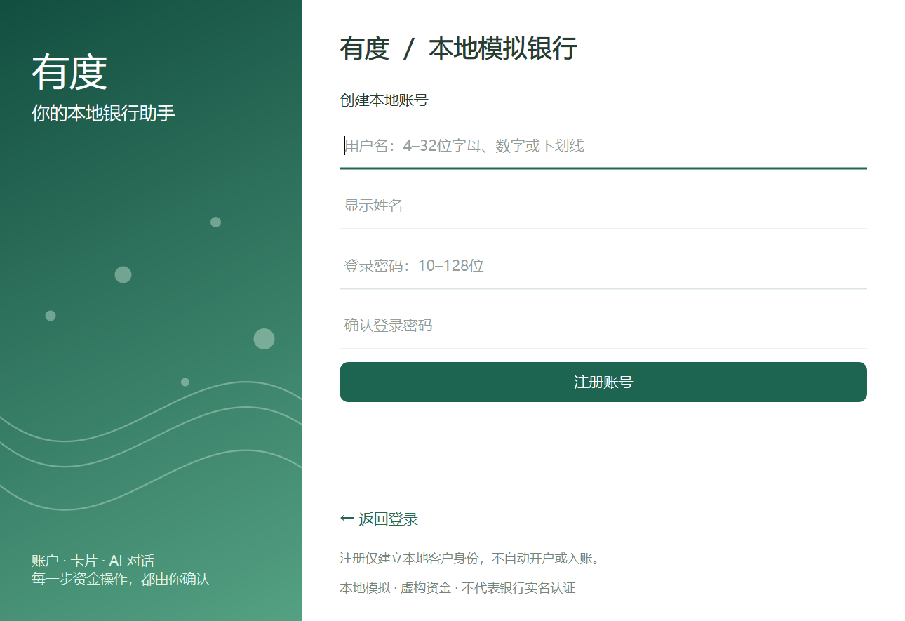
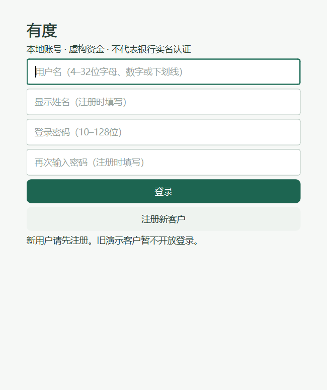
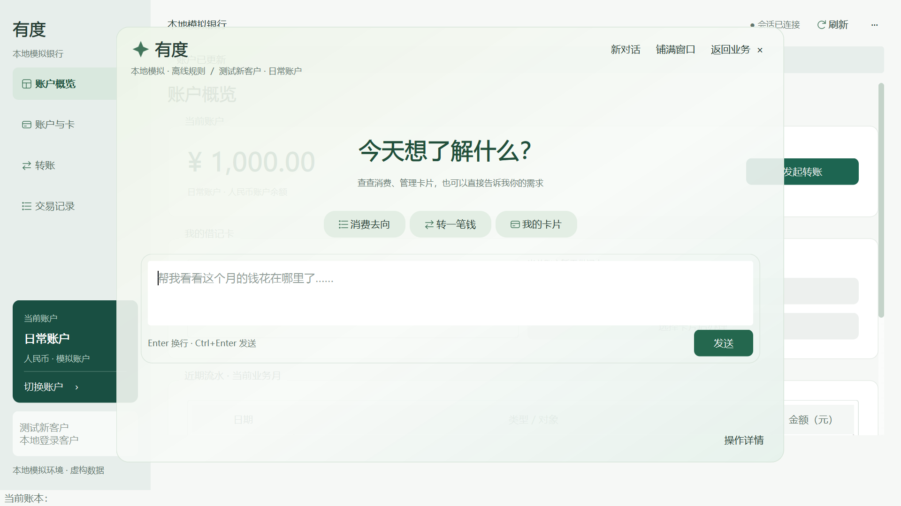
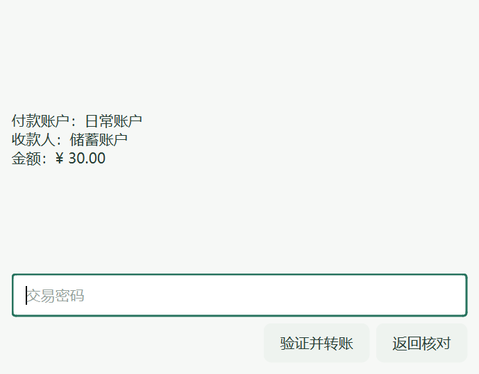

# 本地登录与交易认证实施状态（任务分支待审）

2026-11-01 高风险认证增量：正式登录客户名下所有账户/卡当日转出累计（含本次整批）超过1000元，除交易密码外还需独立手机TOTP。先验证登录密码并扫码绑定，再重新核对原操作；绑定不自动付款。原登录账号、密码、账本、EXE入口保留。下文“仅交易密码”“尚无第二因素”仅为旧版本描述；最新契约、锁定/重放保护、截图和未测项见[高风险转账认证](高风险转账认证.md)。

2026-11-01 最新资金规则：开户、办卡、激活均不自动入账；需要测试资金时，通过已激活卡手动确认“模拟入金”。正式客户仅支持卡间转账。下文1000元开户赠款及其余额结果属于早期版本证据，不再代表当前规则；当前复演、接口及截图见[按卡号转账](按卡号转账.md)。

## 当前桌面接入结果

### 登录与注册分屏调整（2026-11-01，待审）

用户提供金融终端参考图，采用左侧品牌区、右侧表单区结构，沿用有度绿色和原生绘制曲线装饰。登录、注册、首次开户为三个独立页面；登录只显示用户名和密码，注册成功返回登录并自动带入用户名。切页保留非敏感草稿并清除密码，退出后回到登录页。未增加短信登录、记住密码、自动登录或未实现的密码找回入口，后端认证和资金接口不变。

原生窗口860×590逻辑像素，Windows125%及150%真实窗口、隔离SQLite、真实HTTP、离线规则验证：登录→注册→切回登录再返回注册（姓名和用户名保留，密码清空）→注册成功自动返回登录→首次确认开户→交易密码认证30元→退出重登970元。无日常账本写入，无真实模型调用。125%截图为初轮；150%为统一右侧纯白背景后的最终样式。

此前下文520×620及混合登录注册截图属于旧轮次，当前以本节为准。

本次布局任务仓库门禁通过：855项Python、46项Node及pip check；最终白色背景调整后的150%窗口流程再次通过。没有新增真实模型验收，不改变此前认证能力与缺口说明。

正式启动器现在打开原生登录/注册窗口，后台启用持久化local_login模式，demo身份和模拟认证入口关闭。只有显式 `desktop/app.py --demo` 才使用旧开发演示身份。旧客户不能从注册页面认领，所有既有余额和流水保留。

操作复演：启动Youdu.exe→填写用户名、显示姓名、登录密码及重复密码→注册→再次输入密码登录→填写首账户名称→准备开户→核对1000元演示入账并确认→进入账户页。账户与卡菜单沿用原表单。右上“更多→退出登录”返回登录页；有待确认或结果不确定时先处理原操作，退出不伪装回滚。

转账点击确认后获取认证设置状态；首次通过专用掩码对话框重新验证登录密码并设置6位交易密码，设置不直接扣款，需再次核对原转账。后续每笔/整批确认输入交易密码，服务器在原挑战和操作绑定检查后验证，验证结果不进入模型。错误密码保留原确认并给出提示，不进入未知扣款状态；取消密码对话框返回核对，取消业务仍走原拒绝路径。

实际原生窗口、真实HTTP、隔离SQLite、离线规则验证：注册后账户为空，确认开户后1000元；增开储蓄账户后通过自然语言发起30元本人转账，设置密码、认证成功后主账户970元，退出再登录仍970元。服务端重建专项已核对双方970/1030元，重复确认相同回执。另有正式main入口专项确认初始无token且/demo/session返回404。未调用真实模型。

窗口截图：Windows125%与150%，登录窗口520×620逻辑像素；业务窗口按桌面可用区域调整，截图分别保存在[125%](evidence/local-login-20261101/125/login.png)及[150%](evidence/local-login-20261101/150/login.png)。助手默认约55%面积，小窗口按最小高度620回退，可能高于55%，保持居中和不越界。背景单独透明，文字与输入控件保持不透明。

已知缺口：新用户没有预设对外联系人，当前可通过本人多个账户复演转账，尚无普通用户添加其他新客户收款人的界面；本轮没有完整的双客户与批量交易密码实际窗口专项。未实现密码找回、改密、记住登录或生产实名认证。不把本轮专项视为完整安全审计。旧开发默认身份启动专项保留在--demo模式，未放宽资金与原账本重开断言。

下面是前几轮实施历史，其中“启动器尚未接入”已由本节替代。

本轮门禁通过（Python全量、46项Node与pip check）；后补正式启动入口检查与中文按钮文案后，桌面登录/启动专项11项通过，150%实际窗口复演再次通过。首轮扩展桌面测试因缺少business_confirmation导入失败，补充导入后复验通过；失败未作为业务成功统计。测试密码均运行时随机生成且截图在输入前捕获。完整界面验收仍以本节列出的流程与边界为准。

2026-11-01 用户决定：只开放新用户注册；旧客户暂不允许登录，不提供认领或管理员设置旧凭据的入口。旧账本资金与历史保留。此决定取代此前讨论中的旧客户凭据初始化方案。

当前分支 contract/local-login-payment，基于尚未合并的覆盖式助手分支。没有合并或推 main，没有改写日常账本。

已写入但尚未完整交付：
- 助手按约55%面积居中，最小可用尺寸回退；渐变背景使用独立 alpha，未设置窗口整体透明度。
- 独立凭据存储组件：注册随机新客户引用、用户名归一化、scrypt独立加盐哈希、交易密码首次设置与验证；登录和交易密码分别计数，5次错误锁15分钟，计数持久化，重开不清除。无旧客户认领路径。
- 专项：助手/聊天2项、凭据存储2项通过。凭据测试使用临时数据库和随机密码；没有真实模型或本轮可见窗口验证。

尚未接入，不能宣称已有登录安全隔离：
1. API已增加显式 local_login 模式：必须持久化、仅本地、不能同时打开demo；普通业务仍经会话。正式启动器尚未启用。
2. 注册与客户元数据同SQLite事务建立，无账户时只给首次开户的限定上下文；复用原开户确认及明确的1000元模拟入账，不在注册赠款。
3. 本地模式单笔及批量approve在原挑战PENDING时验证交易密码，秘密不传图；界面和批量专项仍待补。
4. 登录/注册/首次开户/交易密码原生窗口及所有调用方适配。
5. 跨身份隔离、旧会话失效、双边/批量资金结果、丢失响应、冻结和重启完整验证，最终全量门禁、截图与PR。

当前启动器仍运行旧演示登录行为，凭据组件尚未被正式入口调用。不得将当前工作区当作已实现注册登录的发行版。

接口增量：POST /auth/register 只接受username/display_name/password；POST /auth/login只接受username/password，返回token/mode/display_name/needs_account；POST /auth/logout空对象，撤销当前会话族；POST /auth/payment-password接受login_password/payment_password，归属来自会话，不接受user_id。未新增认领旧客户接口。resume沿用原otp字段承载专用认证输入，服务端消费后不传入图。已有demo测试模式继续兼容，正式客户端尚待切换，不能将开发demo模式称为认证模式。

接口专项实际结果（ASGI TestClient，非真实TCP或实际窗口）：注册→空账户列表→确认开户→发卡激活→增开储蓄账户→30元本人转账。未设置交易密码拒绝，错误密码拒绝；正确密码后970/1030元，重复确认回执相同；退出旧令牌401，重建服务登录仍为970/1030元；选择旧张伟账户403，demo/session在登录模式404。此轮未做桌面登录验收、真实模型验收或完整批量密码专项。
