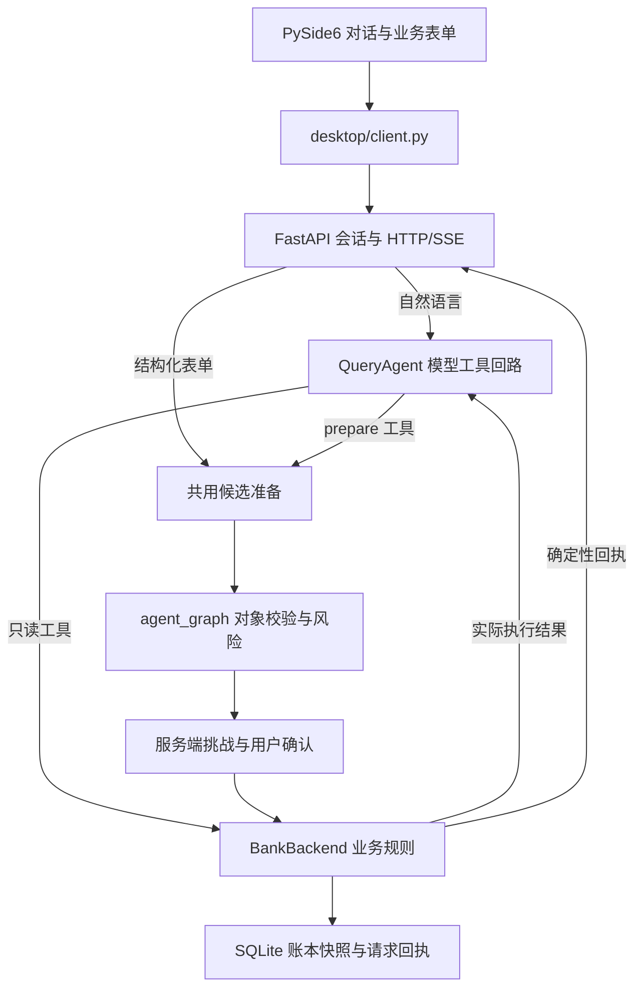

# 实际架构、项目价值与边界

2026-11-01 认证增量（待审）：LOCAL 正式登录转账复用现有风险/确认/资金服务；客户全部账户累计超1000元为RED，交易密码之外追加独立手机TOTP。`api/mfa.py` 在原SQLite中增加密钥密文与消费/锁定/短时授权表，Windows DPAPI保护密钥；认证不进入Agent状态，批量仍整批原子，冻结和资金规则仍在执行时复核。`desktop/security.py` 仅负责绑定界面，`desktop/login.py` 调用原resume提交两项凭据。原EXE和原账本绑定不变。最新验证及边界见[高风险转账认证](高风险转账认证.md)；下文的本机模拟认证仅为历史/开发模式，不是正式客户当前路径。

对应2026-10-27交付核对分支。能力状态见[交付核对](交付核对.md)，目标见实施方案，历史PPT不作为接口依据。

## 运行路径

`desktop/app.py`选择固定账本并启动本地服务，窗口关闭后清理子进程。`window.py`处理会话、确认、网络未知及重试；`preview.py`是默认工作区，共用原控制器；`bills.py`显示真实账单与本地筛选，`orb.py`绘制透明助手入口，不另建业务执行逻辑。账单可选日期接口及附加对方名称字段见桌面应用文档。表单`/bank/form`不让模型重解析。AI走`/agent/chat`；配置真实模型时QueryAgent选择实际工具，无凭据明确离线，不静默降级。

`agent/query_loop.py`保存服务端任务消息、工具调用预算、待执行草稿和实际结果；`agent_graph.py`负责共用准备、风险、确认和执行。场景注册器限制操作与候选槽位，实体解析只能从当前客户实际数据取得对象。模型不能传可信user_id、授权或余额。

`banking/bank_backend.py`及`lifecycle.py`执行业务；`storage.py`持久保存JSON账本快照，不是按每个实体拆关系表。复用事务锁、提交与幂等回执。单笔双方余额和关联流水一起提交；批量在同一事务中复用单笔规则，一项失败整批无资金变化。旧单边流水不伪造补款。

会话身份、查询筛选、模型任务草稿、对象候选、挑战授权、执行回执职责不同。账本及业务结果持久化，Session/图checkpoint/聊天/待确认任务在内存中。重启需新会话查询已有流水/回执，不能续旧确认，也不自动执行遗留草稿。高风险认证门禁保留，桌面新增独立的本机模拟认证窗口，绑定原挑战后恢复原执行；这不是真实独立第二因素。外部认证回调保持优先，非本机演示不开模拟码接口。

## 现实意义

项目检验普通页面与自然语言如何办理同一件事：用户说目标，助手查询并提出操作，用户批准后才产生真实模拟账务结果。它适合教学、银行沙箱交互原型、任务完成度评估；当前证据支持这种可行性，尚无真实客户研究证明效率提升、无生产银行可靠性或商业收益结论。

真正接入银行至少需要银行授权的API/沙箱与接口契约、可验证客户身份和账户权限、交易签名/强认证、同意及撤销机制、密钥管理、隐私合规审查、反欺诈与限额、核心账务及支付清算、对账、失败恢复、审计留存、运维监控和安全测试。应先在合作银行沙箱验证，再依据实际地区与银行要求评审。不能把本地演示客户令牌换成“真实登录”字样就上线，也不能让模型直接获得核心库权限。

作为技术参考，OpenID的[FAPI 2.0最终规范](https://openid.net/specs/fapi-security-profile-2_0-final.html)描述基于OAuth 2.0保护高价值API及发送者约束令牌；这不等于本项目已实现FAPI或满足某地区监管义务。这里列的是接入工程条件，不是法律合规认证。

## 开源参考与评估启发

- [LangGraph](https://github.com/langchain-ai/langgraph)：本项目实际依赖，用于状态图与interrupt确认；本地业务授权和账务规则由本项目实现。没有使用LangSmith托管或自动拥有框架所描述的全部持久执行能力。
- [FastAPI](https://github.com/fastapi/fastapi)：实际HTTP契约与服务依赖；不自动提供银行身份、资金原子性或审计合规。
- [VitaBench](https://github.com/meituan-longcat/vitabench)：仅评估方法参考，指美团团队的交互任务基准，不是其他同名项目。其任务关注歧义澄清、跨场景工具组合、多轮意图变化和最终任务结果。我们据此将本地用例按用户目标记录完整交互、依赖结果和失败，而非只检查工具名或JSON格式。

本项目没有运行官方数据集、环境或评分器，没有官方VitaBench分数，不声称通过该基准。本地八组真实模型例子不是统计代表样本；保留拒付与缺功能，后续可以扩表达覆盖、重复运行和错误分类，无需为评估概念新增多Agent、长期记忆或向量库。

外部参考核对日期2026-10-27，引用用于解释设计与评估，不引用排行榜数值给项目背书。依赖许可和分发义务在打包前另行核对。

## 卡账户升级与模拟认证契约（2026-10-27）

SQLite快照v1/v2升级到v3：每个原账户第一张卡留在原账户，其余卡绑定新建零余额账户。一次SQLite事务内保存升级版本、卡归属与迁移说明；历史流水和幂等回执不改、不补款。v3重开不重复迁移。原始余额始终只存在一处；原账户流水中可能出现迁走卡的历史消费，这是保留原事实。卡当日累计仍按card_id计算，迁移不重置。

`ISSUE_DEBIT_CARD`新增确定性拒绝`ACCOUNT_ALREADY_HAS_CARD`，调用方为表单和Agent同一业务服务；新卡必须在空账户申请。`/bank/accounts`新增兼容字段`card_account_migration`（无迁移为空列表），桌面显示说明并可切换新账户。

新增`POST /demo/verification`仅本机demo可用，需现有Bearer会话，严格字段`thread_id/challenge_id`，不接受user_id/account_id；服务端核对会话归属、当前挑战、操作哈希、风险与有效期。返回瞬态`demo_code`、有效期、剩余次数、当日转出和门槛说明；桌面在独立窗口展示。仍经`/agent/chat`的resume提交decision/otp，不新建资金执行路径。错误/锁定/过期返回409且不扣款；错误三次必须取消重建；批准后的原决定重试复用既有授权和幂等回执，不要求再认证。参数修改或取消使旧挑战失效。认证输入不进模型、checkpoint或日志，重启不保留验证码和待确认任务。

同机显示并输入模拟码只是演示确认交互，不具备真实第二通道的安全属性；生产认证接入仍是缺口。认证阈值沿用当前账户当日累计含本笔超过1000元的已有演示规则，不是对真实银行规则的描述。

## 冻结付款卡的转出限制（2026-10-27续）

按用户反馈，冻结关联卡时账户不可转出。共用`transfer_block_reason`在主图准备与模拟认证入口检查，在`_check_transfer`的原账务事务内再次检查，单笔/本人账户间/整批共用规则；无卡账户仍可按既有授权转账。新增拒绝码`SOURCE_CARD_FROZEN`，页面与AI均展示解冻提示，不生成无效认证要求。没有增加第二套冻结状态，没有更改确认或幂等语义；已完成付款后的历史回执重放仍返回原结果，不假装撤销付款。仅限制付款方，收款和其他账户不变。
