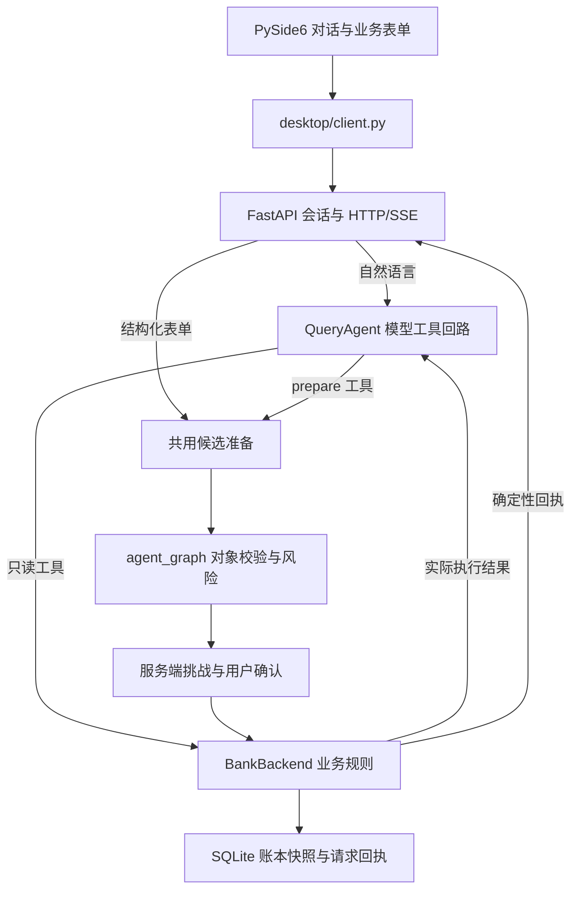

# 实际架构、项目价值与边界

对应2026-10-27交付核对分支。能力状态见[交付核对](交付核对.md)，目标见实施方案，历史PPT不作为接口依据。

## 运行路径

`desktop/app.py`选择固定账本并启动本地服务，窗口关闭后清理子进程。`window.py`处理会话、确认、网络未知及重试；`preview.py`只重排两页视图，共用原控制器。表单`/bank/form`不让模型重解析。AI走`/agent/chat`；配置真实模型时QueryAgent选择实际工具，无凭据明确离线，不静默降级。

`agent/query_loop.py`保存服务端任务消息、工具调用预算、待执行草稿和实际结果；`agent_graph.py`负责共用准备、风险、确认和执行。场景注册器限制操作与候选槽位，实体解析只能从当前客户实际数据取得对象。模型不能传可信user_id、授权或余额。

`banking/bank_backend.py`及`lifecycle.py`执行业务；`storage.py`持久保存JSON账本快照，不是按每个实体拆关系表。复用事务锁、提交与幂等回执。单笔双方余额和关联流水一起提交；批量在同一事务中复用单笔规则，一项失败整批无资金变化。旧单边流水不伪造补款。

会话身份、查询筛选、模型任务草稿、对象候选、挑战授权、执行回执职责不同。账本及业务结果持久化，Session/图checkpoint/聊天/待确认任务在内存中。重启需新会话查询已有流水/回执，不能续旧确认，也不自动执行遗留草稿。高风险认证门禁存在，但桌面没有独立认证提供方，所以只能取消。

## 现实意义

项目检验普通页面与自然语言如何办理同一件事：用户说目标，助手查询并提出操作，用户批准后才产生真实模拟账务结果。它适合教学、银行沙箱交互原型、任务完成度评估；当前证据支持这种可行性，尚无真实客户研究证明效率提升、无生产银行可靠性或商业收益结论。

真正接入银行至少需要银行授权的API/沙箱与接口契约、可验证客户身份和账户权限、交易签名/强认证、同意及撤销机制、密钥管理、隐私合规审查、反欺诈与限额、核心账务及支付清算、对账、失败恢复、审计留存、运维监控和安全测试。应先在合作银行沙箱验证，再依据实际地区与银行要求评审。不能把本地演示客户令牌换成“真实登录”字样就上线，也不能让模型直接获得核心库权限。

作为技术参考，OpenID的[FAPI 2.0最终规范](https://openid.net/specs/fapi-security-profile-2_0-final.html)描述基于OAuth 2.0保护高价值API及发送者约束令牌；这不等于本项目已实现FAPI或满足某地区监管义务。这里列的是接入工程条件，不是法律合规认证。

## 开源参考与评估启发

- [LangGraph](https://github.com/langchain-ai/langgraph)：本项目实际依赖，用于状态图与interrupt确认；本地业务授权和账务规则由本项目实现。没有使用LangSmith托管或自动拥有框架所描述的全部持久执行能力。
- [FastAPI](https://github.com/fastapi/fastapi)：实际HTTP契约与服务依赖；不自动提供银行身份、资金原子性或审计合规。
- [VitaBench](https://github.com/meituan-longcat/vitabench)：仅评估方法参考，指美团团队的交互任务基准，不是其他同名项目。其任务关注歧义澄清、跨场景工具组合、多轮意图变化和最终任务结果。我们据此将本地用例按用户目标记录完整交互、依赖结果和失败，而非只检查工具名或JSON格式。

本项目没有运行官方数据集、环境或评分器，没有官方VitaBench分数，不声称通过该基准。本地八组真实模型例子不是统计代表样本；保留拒付与缺功能，后续可以扩表达覆盖、重复运行和错误分类，无需为评估概念新增多Agent、长期记忆或向量库。

外部参考核对日期2026-10-27，引用用于解释设计与评估，不引用排行榜数值给项目背书。依赖许可和分发义务在打包前另行核对。
