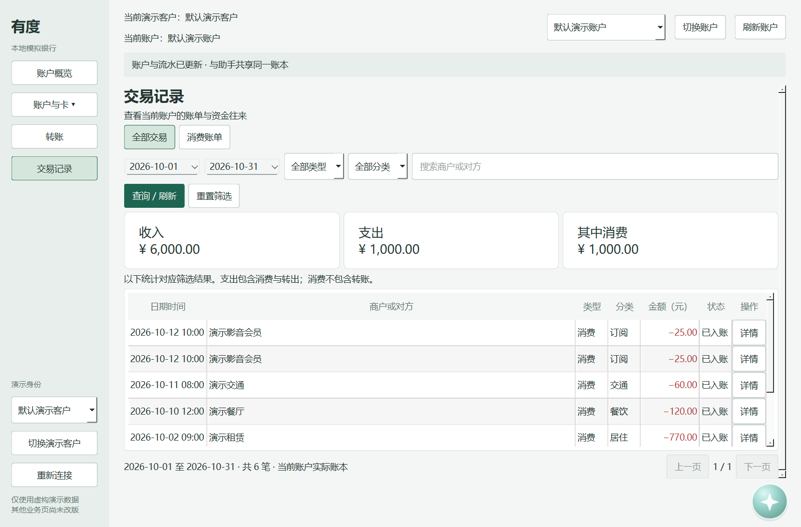
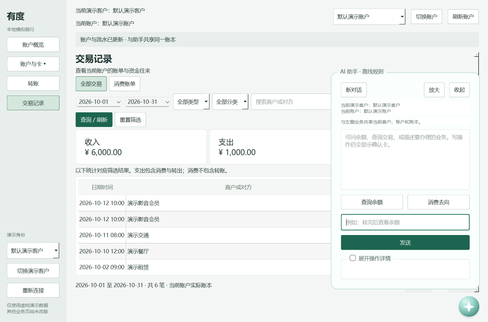
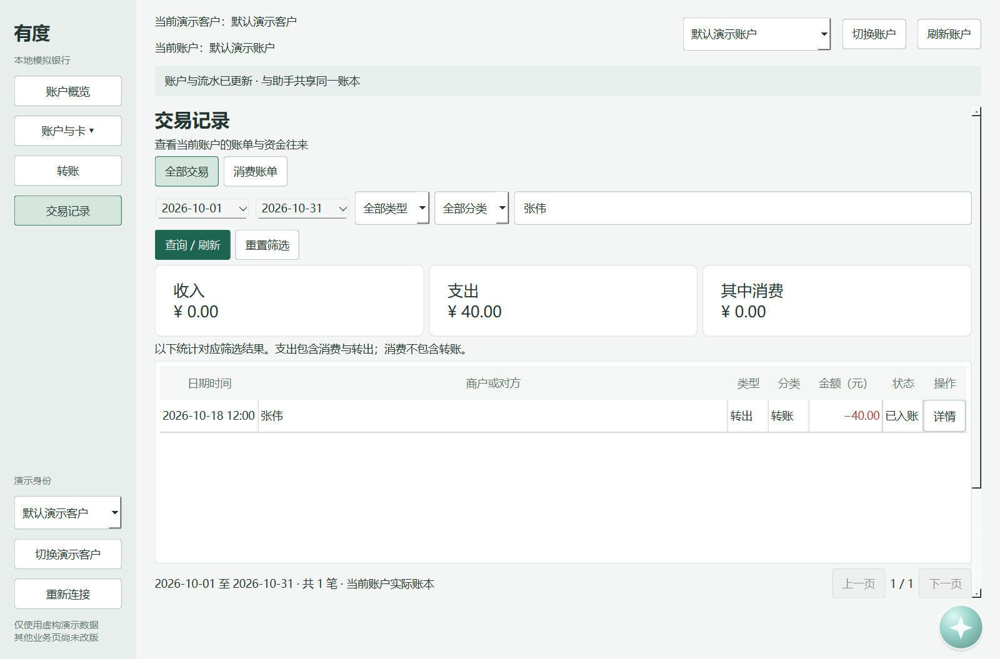
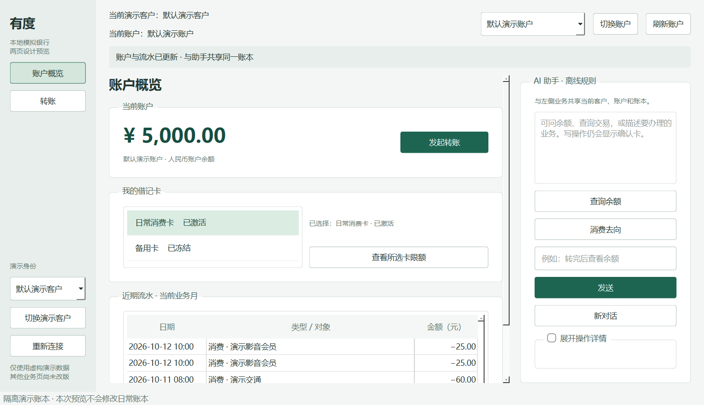
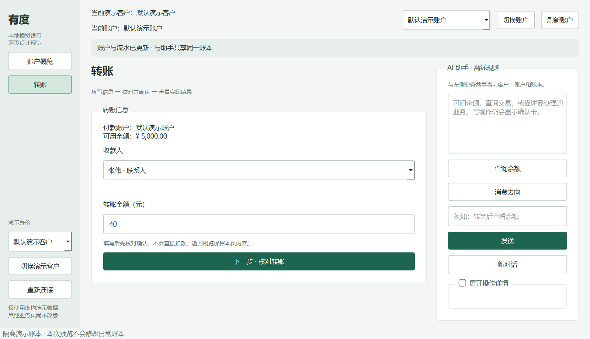
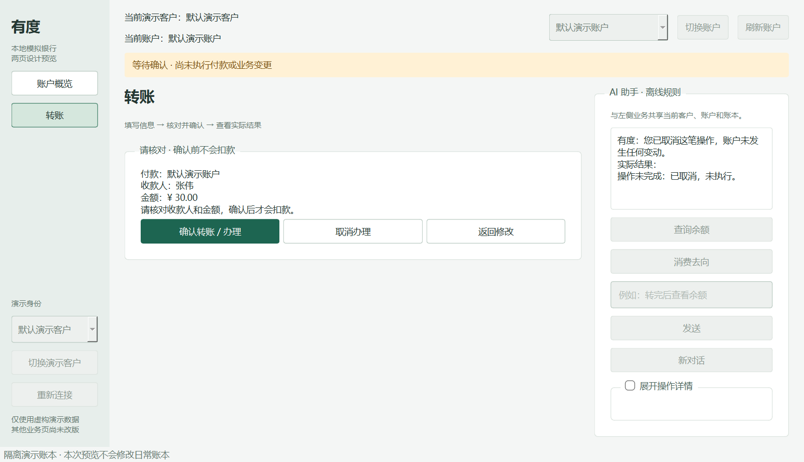
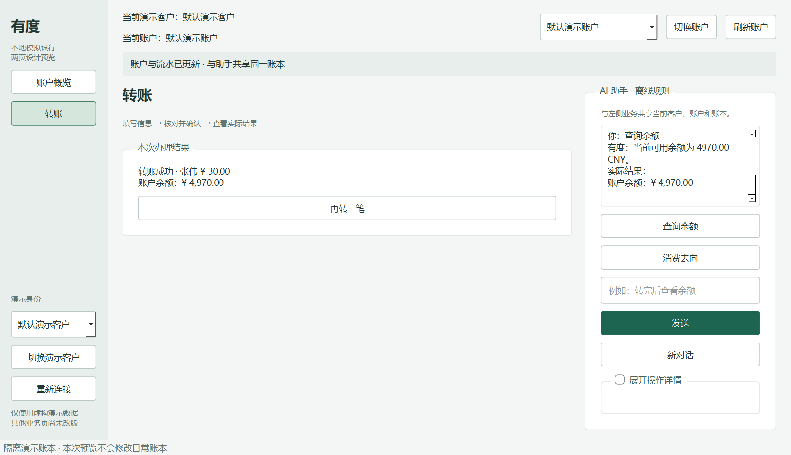

# 最小原生桌面应用

## 已认可方向：账单与悬浮助手（2026-10-27）

本节取代下方历史预览的入口与布局说明。默认 `start-desktop.cmd` 打开 PySide6 原生工作区；`--preview` 保留为兼容别名，`--legacy` 显式使用旧布局。其他业务仍可从“账户与卡”菜单打开原有表单。

右下角半透明悬浮球支持点击展开、收起、放大与键盘焦点；只位于应用窗口内。展开面板显示当前可信客户与账户，复用既有对话、确认、修改、取消和模拟认证控制器。待确认时自动收起聊天，避免挡住确认内容，可重新点球提出最新请求。

交易记录读取当前账户的真实账本，支持日期、类型、分类、商户/对方搜索、消费账单与流水详情。日期输入含结束日；收入包含转入，支出包含转出，消费单列，全部金额对应当前筛选结果。每页20笔是客户端分页；后端一次范围最多366天、100笔，超限要求缩短范围，未实现服务端游标分页或导出。失败清空旧结果和金额并显示原因，不伪装成零笔。成功业务后刷新；切换身份清除筛选并重读。

契约：`GET /bank/bills` 新增可选成对的 `start`/`end`（ISO日期，end不含）；无参数仍查服务业务月。非法、重复或额外参数返回400，超范围按既有 BackendResult 拒绝。身份和账户只取 Bearer 会话，客户端不得指定 user_id/account_id。有转账关联的流水新增可选 `counterparty_name`，来自服务端联系人或关联账户显示名；历史无关联流水不猜名字。`QueryClient.ledger()` 是新调用方；旧客户端省略参数的行为不变，AI共用查询结果获得该附加字段。

窗口复演：`python scripts/capture_bills_desktop.py --visible --output <目录>`，不加 `--visible` 是离屏。脚本使用隔离SQLite与真实HTTP、离线规则，自动结束窗口；启动前告知正在使用电脑的人。本轮实际Windows窗口1280×844逻辑像素、125%缩放：查本月账单→助手查询→表单给张伟转40并确认→搜索张伟，余额5000→4960元，显示一条40元转出，其中消费0元。记录见 [record.json](evidence/bills-orb-20261027/record.json)。





本轮自动化覆盖日期与权限、筛选、空结果、查询失败重试、转账刷新、助手账单及切到收款客户查看入账；未新增真实模型验收，实际截图不代表真实供应商调用。其余页面未全面视觉改版，独立安装包尚未提供。下方测试数量和图片保留为历史版本证据。

## 历史：账户与转账两页预览（2026-10-27，认可前版本）

在 #68 `4552961` 的统一读写任务和整批原子转账基础上，只预览账户概览与转账。双击 `start-desktop-preview.cmd`（等价于 `desktop/app.py --preview`）；原 `start-desktop.cmd` 保持原界面。沿用 PySide6、会话、确定性表单、确认及幂等，不采用 #58，不扩展其余页面。

当前最影响操作的三个问题：账户余额藏在下拉项中，大量平级按钮争抢注意力；转账拆成连续弹窗，难以整体核对与保留输入；办理状态、回执和技术信息混在聊天中，难以区分待确认与已扣款。

预览的信息层级：顶栏固定显示可信客户与账户；左栏只放两页导航，演示身份操作在下方；概览优先显示实际余额和“发起转账”，其次为真实卡包与近期流水。转账集中填写收款人与金额，付款账户默认当前账户，收款人和金额不擅自预填；下一步显示付款账户、收款人和金额，再明确确认。右侧 AI 始终共享当前会话与账本；内部编号与详细回执默认折叠。

卡片从服务端实际列表选择，可直接读取该卡限额。联系人或本人其他账户从当前身份列表选择。同名对象暂不提供不可唯一确定的操作，不偷偷选第一项；卡片其他办理页和同名消歧属于后续任务。返回概览不丢转账草稿；返回修改先取消旧确认，修改后重新确认。切换身份清除旧草稿与旧结果。

视觉约定采用微软雅黑 14px 正文、24px 页面标题、36px 余额；主要区域间距 14/20/24px，绿色主操作、浅灰背景、黄色待确认、红色错误。统一禁用、焦点与选中状态，不以颜色单独表达结果。

| 状态 | 用户可见行为 |
|---|---|
| 正常 / 加载 | 实际余额、卡片、最近五笔流水；读取期间提示正在更新并禁止重复提交 |
| 空结果 | 明确无卡、无流水或无可唯一选择的收款人；不可提交空对象 |
| 就地校验 | 金额必须大于零、最多两位小数，提示余额或单笔限额；服务端仍作最终校验 |
| 待确认 | 显示可信金额和对象，确认、取消、返回修改分开；未批准不扣款 |
| 失败 / 网络未知 | 保留输入；确认响应丢失明确可能已经完成，只重试原决定核对，不另建付款 |
| 成功 / 部分完成 | 显示实际业务回执和余额；多步骤已完成与未完成分开说明，原子批量仍按整批提交状态展示 |

新增只读契约：`GET /bank/desktop-objects`，需要现有 Bearer 会话，无客户端身份参数，服务端用可信当前客户/账户筛选。返回 BackendResult，operation 为 `DESKTOP_OBJECTS`，data 包含 `recipients[{display_name,kind}]` 与 `cards[{display_name,status}]`；拒绝无权账户。调用方为预览的 `QueryClient.workspace_overview()`，与现有账户、账单接口一起读取。没有修改写业务接口、账本格式或旧调用方；表单继续使用 `/bank/form`，服务端重新解析归属并生成确认。

### 实际窗口与操作记录

Windows 原生窗口，客户端逻辑尺寸 **1280×736**，系统缩放 **125%**（DPR 1.25），屏幕逻辑尺寸 1536×864；每张窗口客户区图片为 **1600×920** 像素。窗口直接运行真实本地 HTTP 子服务及隔离 SQLite 账本，使用离线规则，不接触日常账本。截图为运行中的窗口 `QWidget.grab()` 导出；额外 computer-use 截图核对报告窗口已最小化，没有强行切回前台。这不是用户手动操作验收，也不是真实模型验收。

实际操作：选择张伟、填 40 → 返回概览再回来仍为 40 → 准备并返回修改（取消旧确认）→ 改 30、重新确认 → 默认客户 **5000→4970 元** → 助手查余额也为 **4970 元**。实际流水与尺寸记录见 [record.json](images/desktop-preview/record.json)。






复演脚本：`python scripts/capture_desktop_preview.py --visible --output <截图目录>`；默认不加 `--visible` 为离屏截图，不能当作实际窗口验证。使用独立临时账本，脚本关闭后清理。启动可见窗口前应告知用户。

针对性测试通过真实 HTTP 与离屏控件验证了草稿保留、非法金额、旧确认失效、响应丢失后原决定重试、重复确认不重复扣款、助手查得 4970 元、切到张伟查得 430 元以及空联系人状态。部分完成的预览文案已按事件结果实现，本轮未单独完成实际窗口复演；高风险独立认证、同名对象消歧及其他业务页面未新增。用户认可两页方向后再扩展，不将此预览视作全部界面改版完成。

本轮检查：`scripts/check.ps1` 通过（842 项 Python、46 项 Node、pip check），HTTP smoke 通过；随后补充结果未知及高风险提示，针对性桌面流程再次通过。测试进程移除模型配置和日常账本路径；本轮不重复真实供应商验收，以上结果只对应此预览任务分支。

使用 PySide6 原生桌面控件，提供对话、余额查询、消费查询、连续筛选、新对话和模拟转账确认。没有浏览器内核或地址栏。后端与 Agent 复用现有实现；frontend 保留为开发工作台。

## 启动

首次运行 `./scripts/setup-desktop.ps1` 安装基础与桌面依赖，然后双击根目录 `start-desktop.cmd`。也可运行 `.venv/Scripts/python.exe desktop/app.py`。启动器自动启动本地服务，关闭窗口时清理服务。当前是源码启动版，仍依赖 Python 3.10 与仓库虚拟环境，尚未提供独立 EXE 安装包。

真实模型配置沿用 BANKAGENT_MODEL_* 环境变量，优先读取进程环境，缺失项读取 Windows 当前用户环境。密钥不会写入命令行或界面；未配置时明确显示离线规则。可以连续询问「最近钱花在哪里了」「只看餐饮」「列出超过一百的」。

### 账本位置与启动失败

窗口底部显示本次实际使用的账本绝对路径。BANKAGENT_DB_PATH 优先取进程环境，再取 Windows 当前用户环境；都未配置时使用默认目录。相对路径固定相对于仓库根目录，启动器所在的工作目录不会另选账本。

目录或文件不可写时，启动前停止并显示原路径及权限处理提示；数据库损坏/不兼容、占用、磁盘满、模型配置和依赖问题分别提示。不会自动回退到内存或临时库，不会删除、清空或重建已有文件，也不会自动修改目录权限。错误提示不包含模型服务原始异常或密钥。

如以前通过临时启动器使用了已有账本，应明确配置那个原文件，而非另外新建路径。Windows 可将原文件绝对路径保存到当前用户环境（将示例替换为实际原账本）：

```powershell
$ledgerPath = 'C:\你的原目录\manual-test.sqlite3'
if (-not (Test-Path -LiteralPath $ledgerPath -PathType Leaf)) { throw '原账本不存在，请核对路径' }
[Environment]::SetEnvironmentVariable('BANKAGENT_DB_PATH', $ledgerPath, 'User')
```

关闭旧应用后，双击本版本 start-desktop.cmd；应用会补读用户环境，无需重新登录 Windows。若启动终端内已有 BANKAGENT_DB_PATH，其值优先，须先核对。设置路径只选择文件，不迁移数据。权限仍不足时必须修复该路径的权限后重试；不以重置数据解决权限问题。

2026-10-27 启动修复验收（基于 #56 的 a5b2008，新增实现见对应修复 PR）：20 项针对性检查通过；完整门禁 762 条 Python、46 条 Node 及 pip check 通过，隔离 HTTP 冒烟通过。覆盖不可写目录、文件/目录冲突、损坏/空/未知版本数据库原样保留、模型配置错误、不同启动工作目录，以及真实 main/原生离屏控件/子服务连续启动两次读取同一笔已保存的转账余额。

使用既有试用账本的后台真实模型余额查询连续两次通过，余额一致，文件字节哈希前后相同。实际窗口通过正式 start-desktop.cmd 打开、关闭并重开，显示同一路径与 4,960 元余额；两次窗口内余额对话均返回“模型暂时不可用”，如实保留为未通过的外部模型调用体验，不记为端到端自然语言成功。启动与账本读取已验证，模型调用稳定性需另行定位。首次全量检查因运行环境带模型配置而调用外部服务失败；隔离模型与账本环境变量后全量检查通过，未放宽断言。

## 当前边界

### 受控切换演示客户与查看入账

当前任务分支在 #62 `699d3a3` 上新增固定演示客户切换，尚未合并。窗口显示“当前演示客户”，下拉名单由服务端提供，包含默认客户和张伟；这不是注册或真实登录。

复演：默认客户发起“给张伟转40元”并确认 → 选择“张伟（演示客户）”、点击“切换演示客户” → 点击“本月流水”查看转入40元及关联流水号 → 选择默认客户并切回。新测试账本结果为默认客户 5,000→4,960 元、张伟 400→440 元；已有账本按实际余额计算，不重置成这些数值。

“本月流水”按账本业务日期查询当前账户的整个自然月，展示起止范围；直接调用与 AI 账单场景共用的后端查询，不依赖模型可用性。客户选择后落到该客户固定默认账户；如需查看此前增开的账户，再用账户选择框切换。

- 有待确认业务或正在执行请求时不能切换，先确认或取消。成功切换后旧对话、未发送草稿、确认区和账户展示清空，重新读取当前客户；银行账目不变。
- 同次连接下此前账户切换产生的会话一并失效，旧令牌不能查询或恢复旧挑战。另一独立连接不被注销。切回默认客户获得新会话，不恢复旧对话；重启也从默认客户进入，已入账资金保留。
- 切换响应丢失时不声称成功，也不自动重试；清除界面身份和旧令牌，提示重新连接默认客户。服务明确返回忙碌拒绝时保留当前会话。
- 固定演示客户切换只在本机 Demo 模式开放，即便开发服务允许局域网，也不向远端开放这两项客户入口。不接受客户端 user_id、account_id、任意客户或额外字段；不会创建缺失账户。

接口与兼容：新增 `GET /demo/customers`（名单及当前选择引用）、`POST /demo/customer-session`（仅 customer_ref）、`GET /bank/bills`（当前会话账户本月账单 BackendResult）。前两者要求本机演示模式和已有会话；账单接口要求会话，不接受账户选择参数。`/demo/session` 仍只接受空体并创建默认会话，原账户切换响应不变。内部会话新增服务端 family_id，以撤销同次连接的旧账户会话，不进入公开响应或模型。桌面是新增接口调用方，旧开发工作台不增加客户选择；账本格式、资金规则、模型适配不变。

验证入口：`tests/test_demo_customers.py` 覆盖实际主图/SQLite、公开切换、双方账单、服务重建、伪造身份、跨账户访问、旧令牌/线程/挑战、待确认和本机边界；`tests/test_desktop_customers.py` 用真实子进程 HTTP 服务与原生离屏控件点击切换和流水按钮，检查余额 4,960/440、关联入账及切回后的显示清理。隔离账本、离线自然语言解析，不是实际屏幕或真实模型验收。未使用用户试用账本。

该轮完成的是已存在固定演示客户之间切换；后续任务分支已新增“创建演示客户”按钮，将虚构客户与首账户同事务建立，再通过受控名单切换、申请卡和激活。见 [演示客户首次开户](账户与借记卡.md#演示客户首次开户2026-10-27待审分支)。普通业务表单也已接入 [确定性入口](账户与借记卡.md#确定性表单入口2026-10-27待审分支)。

2026-10-27 本任务最终版本：780 项 Python、46 项 Node、pip check 及 HTTP smoke 通过。真实子服务与原生离屏控件验证包含在门禁中；实际窗口人工操作及真实模型调用未验收。

- 桌面支持模拟转账、开户、发卡、激活、刷卡消费、冻结与解冻的请求和服务端确认区。修改参数须先取消再提出新请求；高风险转账因独立认证未接入，只能取消。账户列表只显示本人的账户，点击切换后建立新会话。理财推荐仍待补齐。流程及验收边界见 [账户与借记卡](账户与借记卡.md)。
- 表单待确认时可点“修改表单”，应用先确认取消旧挑战，再回填原字段供编辑；新内容重新确认。取消结果不确定时先重试原决定，不同时保留两张有效确认卡。
- 本地模拟银行，账目与已执行回执默认保存在 SQLite；聊天与待确认操作仍在内存。路径和边界见 [本地持久化](本地持久化.md)。
- 服务只绑定 127.0.0.1，由系统分配空闲端口，强制关闭局域网访问。多个窗口默认使用同一本地账本，数据库事务串行处理业务调用。
- 网络查询在后台线程运行，不阻塞窗口；完整校验事件流后展示结果。失败不自动重发，缺失结束事件不显示为成功。
- 正常关闭、启动失败、超时或父进程管道断开都会清理服务。关闭时即使进程中断，SQLite 也保证未提交事务回滚；已提交记录保留。

## 技术与验证

仅新增 PySide6-Essentials 和 shiboken6 可选依赖，不需要 Qt WebEngine、WebView2 或 .NET。用户于 2026-10-26 明确选择原生桌面控件路线，原内嵌网页方案不再使用。

自动化覆盖服务生命周期、只允许本机访问、桌面客户端实际 HTTP 查询、写操作未确认不扣款、异常配置清理和不完整事件流拒绝。普通回归不调用真实模型。实际窗口与真实模型验收结果见本次 PR。

2026-10-26 验收：scripts/check.ps1 通过（698 条 Python、45 条 Node 测试及 pip check）；真实 TCP 业务冒烟检查通过。使用 computer-use 实际操作原生窗口，完成「最近钱花在哪里了 → 只看餐饮 → 列出超过一百的」三轮真实模型查询，显示金额依次为 1,000 / 120 / 120 元，且后两轮保留餐饮筛选条件。界面正常显示，发送按钮与后台查询可用；关闭后核对本次应用与服务进程均已退出。此验收不代表安装包、持久化或写操作界面已经完成。

审查补充：首次连接失败后提供「重新连接」，重连成功清理旧会话引用并恢复输入。会话响应先校验再更新令牌；拒绝未完整结束、消息字段非法或卡片结构异常的事件流。新增原生控件离屏回归验证初始连接失败可恢复，不占用用户屏幕。补充后完整门禁为 703 条 Python、45 条 Node 测试通过。

转账确认区仅使用服务端确认卡与中断信号，校验挑战编号、操作哈希及风险等级。提交时禁用按钮；连接中断后保留原决定，只能重试同一决定核对结果，不允许改成相反决定或另建会话。完整失败响应允许重新开始，但先核对账目；跨重启仍需新会话，当前没有旧回执检索界面。

2026-10-26 转账增量验收：完整门禁 721 条 Python、45 条 Node 与 pip check 通过；HTTP smoke 通过。自动化覆盖补信息、取消后改金额、确认、回执重放、重启保留余额、确认绑定校验，以及原生按钮连接真实本地服务后的重复点击。实际屏幕使用单独临时账本和真实模型，生成张伟 40 元确认区并取消，界面恢复输入，数据库余额保持 5,000 元且无已执行回执。成功确认与重启路径由离屏控件/真实 HTTP 自动化验证，不冒充本轮实际屏幕点击确认。
