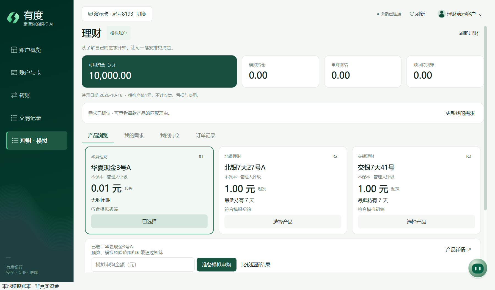

# 理财界面与首次引导

2026-11-01，基于 #92 的 `894491f`；任务分支 `feat/wealth-onboarding-design`。本轮只调整原生桌面的展示和问卷入口，不修改产品、筛选、认证、订单状态或资金规则。

## 页面调整

可用资金、模拟持仓、申购冻结、赎回待到账分成四张概览卡。产品由大表格改为三张可选卡片，突出管理人评级、起投金额、持有要求与匹配状态，保留非保本标识。选中后在下方展示匹配理由和申购操作。

产品全名、份额代码、常规费率、真实渠道待核实说明和官方说明书入口移入“产品详情”。主页面持续显示模拟净值与资金边界，不把产品资料简化成收益承诺。订单记录保留，演示控制默认收起。

## 首次使用问卷

1. 第一次进入理财页、数据加载成功且当前可以操作时，如果没有有效问卷，自动弹出引导。进行中的确认或认证不会被弹窗打断。
2. 两步分别填写资金安排与风险偏好；十项回答不预选。金额和天数先校验格式，缺项提示具体字段。
3. “稍后填写”或关闭弹窗不保存、不办理业务。同一次登录内不会因刷新、重新进入或切换自己的账户反复提醒；重新登录且仍未完成时会再次引导。
4. 可直接浏览产品和官方资料；点击比较或申购时，没有有效问卷会重新打开问卷，不直接准备订单。
5. “核对我的需求”仅发起原有保存确认，用户仍需在业务确认卡核对后保存。拒绝保存不会把草稿视为有效问卷。
6. 已保存且有效时直接进入理财页；上方“更新我的需求”和“我的需求”页签都可修改。过期时重新引导。切换用户或账户会清空本地未提交草稿，加载服务端属于当前客户的答案。

问卷仍然只是模拟需求筛选，不生成银行正式风险评级。页面引导不代替后端检查，Agent与表单仍由同一后端校验。

## 验证与图片

自动化覆盖首次打开、跳过后不重复提醒、推荐／申购入口补填、两步校验、只发起确认而不隐式保存、有效问卷复用、过期提醒及切换用户清空草稿。既有原生强认证申购、赎回与订单账务回归继续通过。

实际Windows窗口以125%缩放复演，包含宽窗口和1040×720逻辑尺寸；[最终记录](evidence/wealth-design-20261101/final/record.json)使用隔离SQLite，1000元申购／400份赎回后仍为现金9400元、持仓600元。测试没有访问日常账本。本轮未重复调用真实模型，模型与业务协议未变。

全量门禁898项Python测试、46项Node测试及pip check通过，HTTP smoke通过；最后的引导与桌面专项6项复测通过。详见[检查记录](evidence/wealth-design-20261101/check.txt)。敏感字段扫描仅命中既有测试占位符与配置变量名。
