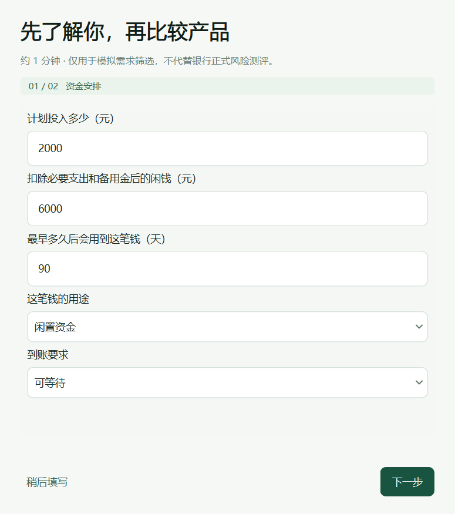
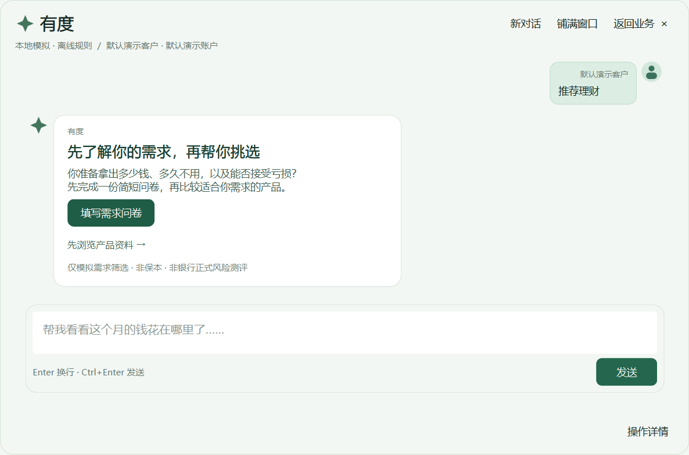
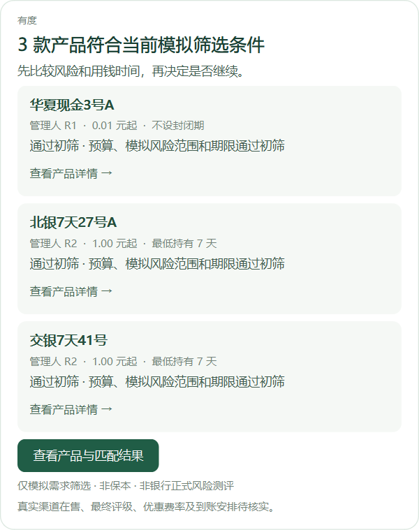

# 理财界面与首次引导

2026-11-01，基于 #92 的 `894491f`；任务分支 `feat/wealth-onboarding-design`。本轮只调整原生桌面的展示和问卷入口，不修改产品、筛选、认证、订单状态或资金规则。

## 页面调整

可用资金、模拟持仓、申购冻结、赎回待到账分成四张概览卡。产品由大表格改为三张可选卡片，突出管理人评级、起投金额、持有要求与匹配状态，保留非保本标识。选中后在下方展示匹配理由和申购操作。

产品全名、份额代码、常规费率、真实渠道待核实说明和官方说明书入口移入“产品详情”。主页面持续显示模拟净值与资金边界，不把产品资料简化成收益承诺。订单记录保留，演示控制默认收起。

## 首次使用问卷

1. 第一次进入理财页、数据加载成功且当前可以操作时，如果没有有效问卷，自动弹出引导。进行中的确认或认证不会被弹窗打断。
2. 两步分别填写资金安排与风险偏好；十项回答不预选。金额和天数先校验格式，缺项提示具体字段。
3. “稍后填写”或关闭弹窗不保存、不办理业务。同一次登录内不会因刷新、重新进入或切换自己的账户反复提醒；重新登录且仍未完成时会再次引导。
4. 可直接浏览产品和官方资料；点击比较或申购时，没有有效问卷会重新打开问卷，不直接准备订单。
5. “核对我的需求”仅发起原有保存确认，用户仍需在业务确认卡核对后保存。拒绝保存不会把草稿视为有效问卷。
6. 已保存且有效时直接进入理财页；上方“更新我的需求”和“我的需求”页签都可修改。过期时重新引导。切换用户或账户会清空本地未提交草稿，加载服务端属于当前客户的答案。

问卷仍然只是模拟需求筛选，不生成银行正式风险评级。页面引导不代替后端检查，Agent与表单仍由同一后端校验。

## 验证与图片

自动化覆盖首次打开、跳过后不重复提醒、推荐／申购入口补填、两步校验、只发起确认而不隐式保存、有效问卷复用、过期提醒及切换用户清空草稿。既有原生强认证申购、赎回与订单账务回归继续通过。

实际Windows窗口以125%缩放复演，包含宽窗口和1040×720逻辑尺寸；[最终记录](evidence/wealth-design-20261101/final/record.json)使用隔离SQLite，1000元申购／400份赎回后仍为现金9400元、持仓600元。测试没有访问日常账本。本轮未重复调用真实模型，模型与业务协议未变。

全量门禁898项Python测试、46项Node测试及pip check通过，HTTP smoke通过；最后的引导与桌面专项6项复测通过。详见[检查记录](evidence/wealth-design-20261101/check.txt)。敏感字段扫描仅命中既有测试占位符与配置变量名。

## 聊天理财展示补记（2026-11-01）

`fix/wealth-chat-cards` 在原生助手中按后端结果显示不同卡片：

- 无有效问卷：简短需求引导、填写／更新按钮和浏览资料入口，不展示三款未筛选产品的长列表。
- 已筛选：产品简称、管理人风险等级、起投、持有要求及后端通过／排除理由；费用、代码与官方说明书留在产品详情。
- 账户查询：可用、持仓、申购冻结和待到账分别显示。订单回执区分申请数量、确认数量、部分成交和待到账状态。
- 去除与结构化卡片重复的固定提示及离线摘要；保留其他解释、澄清和错误。原完整回执仍可从操作详情核对。
- 产品详情、持仓与订单按钮负责导航；保存问卷后的匹配按钮后续修正为只读推荐，见下节。填写问卷仍须核对保存，交易仍走原有确认和认证。选择先浏览不会强制再次弹问卷。
- 助手面板使用不透明背景；气泡按实际换行高度排版，活动对话的输入框缩短，为正文留出空间。

实际窗口和导航验证使用临时 SQLite 与离线规则，不调用真实模型，不访问日常账户；证据见 `evidence/wealth-chat-20261101/`。提交包任务继续暂停，本次不替换或上传比赛材料。

本次完整门禁：902 项 Python 测试（186.51 秒）、46 项 Node 测试、pip check 及 HTTP smoke 通过。敏感字段扫描仅命中既有测试占位符和配置字段名。

后续按反馈收紧对话底部：将“操作详情”移到输入框内、发送按钮旁；空状态提示隐藏，不再为其和独立底栏预留空间。活动对话的输入框贴近面板底部正常边距，释放的高度交给聊天区；有待确认、错误或忙碌状态时仍显示提示。

## 保存问卷后的推荐入口修复（2026-11-01）

原“查看匹配产品”误绑定产品浏览导航，没有请求推荐。现在该按钮通过已有结构化表单入口发起 `RECOMMEND_WEALTH`，服务器重新读取当前客户问卷并筛选，在当前对话展示匹配数量和每款通过／排除理由。页面不跳转，未发送草稿保留；从旧卡片发起时跟随新结果滚动。理财页“比较匹配结果”也打开对话展示筛选回执。缺失／过期问卷和零匹配均由原服务端与卡片逻辑处理。

按钮不调用语言模型猜测操作，不使用聊天旧快照生成结论，不申购、不扣款。忙碌时不重复发请求；有待确认、结果未知或连接受阻时不覆盖原操作。API、后端筛选及交易授权协议未改动。比赛提交包保持暂停。

回归覆盖真实本地HTTP下的保存→点击→筛选回执，连续点击去重、待确认保护、页面比较入口，以及既有申购／赎回账务。Windows原生窗口使用临时SQLite与离线规则复演，核对草稿保留、自动滚动和无订单／余额变化，未使用日常账本；证据见[检查记录](evidence/wealth-recommend-action-20261101/record.json)与[实际匹配卡片](evidence/wealth-recommend-action-20261101/matched-card.png)。

完整门禁905项Python测试、46项Node测试、pip check及HTTP smoke通过。随后补充自动滚动，并在最终代码上复测聊天与完整桌面理财流程7项通过；原生窗口复演也通过。测试等待了推荐回执后异步排队的账户刷新，再发起下一项业务，没有放宽忙碌保护。
