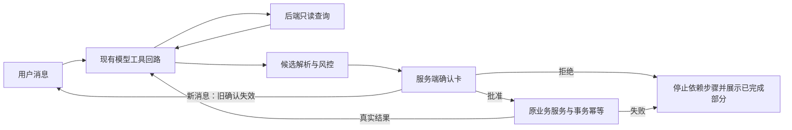

# 首条真实 Agent 查询回路

## 范围与当前证据

本次接通原生 function calling：模型选择只读工具 → 后端执行 → tool 消息反馈实际结果 → 模型继续调用或自然回答。支持同一请求内多个查询，以及“最近钱花在哪里 → 只看餐饮 → 列出超过一百的”的跨轮筛选。

协议依据：[DeepSeek Tool Calls](https://api-docs.deepseek.com/guides/tool_calls/)。通过已有 httpx 适配器发送 tools 与 messages，不新增 SDK。离线模式保持原行为，不把离线或测试替身称为真实模型成功。

自动化使用确定性的模型替身/MockTransport与真实内存银行后端，不证明实际供应商的语言理解效果。真实模型验收使用 scripts/check_query_model.py，需本机配置凭据；未运行通过前不能宣称完成真实供应商验收。

## 2026-10-26 真实模型验收记录

在代码提交 `82693a046fdfa2800b0ee19f42062cf162d4877a` 上运行 `scripts/check_query_model.py`，使用本机配置凭据及默认模型 `deepseek-flash`，退出码为 0。本次仅执行查询，没有资金操作，也未将凭据写入仓库。

| 连续输入 | 后端结果 | 耗时 |
|---|---|---|
| 最近钱花在哪里了 | 100,000 分，5 笔消费 | 2.27 秒 |
| 只看餐饮 | 12,000 分，1 笔消费，类别为餐饮 | 2.17 秒 |
| 列出超过一百的 | 12,000 分，1 笔消费，保留餐饮并添加严格大于 10,000 分条件 | 1.69 秒 |

脚本校验了同一会话中的 COMPLETED 状态、QUERY_BILLS 回执、金额及类别/金额条件继承。本次是一次三轮真实调用结果，不代表重复运行成功率、全部自然表达或模型措辞准确性已全面验收；未执行浏览器视觉验收。后续提交仅记录此证据，业务代码未变化。

> 以下查询阶段的工具与限制是 PR #50 历史实现；任务3的当前增量见文末，不能据此判断本分支仍不支持读写组合。

## 契约增量

- `OpenAICompatibleModel.complete_tools(messages, tools, require_tool=False, timeout=30)` 返回供应商 assistant message。原有 predict/health 接口保留，非查询场景继续使用原候选路径。
- `create_app`、`Service`、`BankAgentRuntime` 增加服务端 `query_model` 注入。只传 candidate_model 的旧测试/集成仍验证旧候选边界；正式 create_demo_app 自动把已配置模型同时接入两条路径，不在工具调用失败后回退。
- 新只读后端 `query_expenses(context, start, end, category=None, merchant=None, amount_gt_minor=None)` 返回现有 QUERY_BILLS/BackendResult，新增 data.filters。只算 EXPENSE，金额为整数分；类别精确匹配，商户按子串匹配，金额严格大于；按时间及交易引用排序。
- 筛选在条数限制之前执行。匹配结果超过100条明确拒绝，不以截断数据冒充完整汇总。日期左闭右开，最长366天；当前业务日期仍由模拟后端时钟提供。
- BankAgentState 新增 `query_results`，保存本轮完成的只读结果，下一轮清空。SSE 继续使用现有 evidence/result 卡，逐项展示本轮成功结果；金额、日期与筛选条件由后端确定性展示。
- 查询条件与授权分离：QueryAgent 在服务端按用户、账户、thread 保存最近一次完整成功查询，30分钟失效，重置和进程重启清除。不把长期聊天记忆或持久化提前纳入本次。

## 工具与边界

| 工具 | 用途 |
|---|---|
| query_expenses | 消费汇总和明细；inherit=true 继承，显式字段替换，null 清空；新查询 inherit=false 默认近30天 |
| get_balance | 当前登录账户余额；不接收身份参数 |
| ask_user | 缺信息或能力说明，不产生业务结果 |
| handoff_banking | 交回原有转账、卡片等处理流程，不执行、不授权 |

查询路径在关键词预判前交给模型。其他业务经 handoff_banking 后仍走原确认、安全和幂等流程；这不是复杂写任务编排的完成。本轮不支持同时混合查询和写操作的工具计划，明确失败而不静默丢弃其中一部分。

模型不能提供 user_id、account_id、授权字段或任意函数名。余额工具只向模型投影余额和币种，不泄露风控累计值。工具结果、历史与商户文本不是指令。错误或拒绝结果由程序决定状态，不让模型改写为成功。

回路最多5轮模型响应、6次工具调用，45秒预算；网络请求受剩余预算及供应商超时约束，响应回来后再次检查预算。不执行模型生成的代码，不开放写工具。最终自然语言是模型解释，不作为账务或授权依据；业务卡片才是后端结果。仍需真实模型评估措辞准确性。

## 运行与验证

在配置模型环境变量的终端、仓库根目录运行：

```powershell
.\.venv\Scripts\python.exe scripts/check_query_model.py
.\.venv\Scripts\python.exe -m uvicorn frontend.dev_app:create_app --factory --app-dir src --host 127.0.0.1 --port 8021 --workers 1 --no-access-log
```

check_query_model 使用独立进程内数据，连续查询三轮并核对汇总和筛选条件，不发起资金操作。默认供应商/模型沿用现有配置，最终产品选型仍未冻结。

自动化覆盖原生请求/响应、工具结果再反馈、跨轮继承与重置、空结果、金额边界、用户/账户/会话隔离、过期与重置、未知工具和越权参数、模型失败、调用限制及转账确认回归。浏览器视觉验收与真实供应商验收分别记录，不用替身替代。

## 任务3：统一读写回路（2026-10-27，待审）

沿用 QueryAgent、模型适配器及主图，没有另建调度框架。原生 prepare_* 工具只产生注册场景的候选名称/金额；普通表单和 AI 都进入 resolve_entities → security_policy → interrupt → execute_operation。执行结果回到同一模型工具会话，模型再选择实际查询或下一项候选。每项写入分别确认，失败或拒绝停止后续依赖步骤。



上下文分工：最近成功查询条件仍存 `_contexts`；未完任务的工具消息、候选、结果和预算另存 `_tasks`，按可信用户/账户/thread 隔离，30分钟失效。对象名称经既有 registry 解析；授权始终只存在 ChallengeStore。任务采用顺序依赖，失败后停止后续步骤，不支持并行分支任务。

接口兼容：HTTP 请求字段、resume 格式和六类 SSE 事件不变。模型对话处于待确认时，同 thread 的新 message 不再一律 RUN_BUSY：服务端先拒绝旧挑战并移除旧确认引用，再理解最新消息；即使后续模型失败，旧卡也不能复活。“先看余额”只查余额并保留任务草稿，继续原操作必须重新准备确认。表单和离线模式仍按原确定性确认入口办理；执行中全局互斥仍生效。

State 新增服务端 `task_loop` 和 `api_request_id`。后者保持同次 SSE/确认恢复的请求标识稳定；同任务下一项写入使用新的内部 request_id 和授权/幂等记录，因此两笔相同金额也须分别确认。终态继续保留最后写操作的绑定，重复确认重放实际回执。query_results 现在包含已核实的查询和执行结果，可在下一张确认卡之前及失败时展示。调用方是 API 与桌面；第三方消费 SSE 时应允许一个任务有多张结果卡和后续确认卡。

工具准备集合来自启用的场景声明，未启用订阅交易；余额、消费、完整流水及已有卡片/限额查询继续调用现有后端。旧 handoff 仅保留兼容返回处理，不再向新模型调用提供写业务跳回旧路径的工具。公开请求或工具参数不能指定 user_id、account_id、授权或实体内部 ID。

预算：每次运行至多5轮模型响应、45秒；整个未完任务累计至多12次工具调用、17轮模型响应，确认/补充信息不刷新累计调用预算。人等待确认的时间不占模型调用的45秒。任务和确认不跨服务重启，已提交账本及幂等回执仍按原 SQLite 方案持久化。

可复演输入：
- “先查一下余额，够的话给张伟转40元，转完让我看看记录。”确认前余额5000元；批准后4960元，张伟400→440元，完整流水能找到同一 transfer_id。
- “确认我的余额能够支付后，向李娜汇出二十五块五毛，办完核对一下流水。”在上一笔后继续执行，余额4934.50元。
- 新提“给张伟转40元”，待确认时说“改成三十元”，新卡为30元；再说“先看看余额，暂时别转”，余额不变；“不转了”结束草稿，旧卡批准返回409。

证据：`scripts/check_task_model.py` 在临时 SQLite 中实际调用已配置供应商，上述两种对象/金额/措辞、修改、先查询和取消均已通过；未触碰用户日常账本。脚本打印工具回执操作及业务状态，不输出模型内部推理。它是本次抽样验收，不能代表全部自然表达稳定性。

离线模型替身配合真实 HTTP/银行服务验证正常、缺项、修改、取消、未授权参数、执行失败、确认重放、两笔相同付款分别确认及后续模型失败。原生 PySide6 用离屏窗口与进程内 HTTP 传输适配验证输入框、修改、先查询、继续、确认及关联流水展示；没有操控用户屏幕，也没有把它当成实际可见窗口验收。

已提交付款后模型故障会保留真实付款回执，提示后续查询未完成并等待用户补充；不自动重试付款、不把任务宣称为全部完成。剩余：更广泛真实模型语言评估、任务跨进程恢复；后者未在本次实现。下一条建议流程是理财推荐的客户画像读取→适配筛选→依据解释（仅推荐，不交易）。

本分支最终检查：824项 Python 回归、46项 Node 测试、pip check 通过；清除命令进程的 BANKAGENT_MODEL_* / BANKAGENT_DB_PATH 后，独立 HTTP 服务冒烟通过。首次冒烟继承本机配置，在批准前的预期状态断言停止，没有发送批准；不是一次隔离通过记录。最终版本另跑真实模型脚本，两笔转账及待确认修改/查询/取消均通过。
