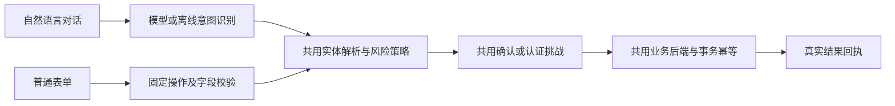

# 账户与借记卡后端基础

模拟银行后端已接入原生桌面表单、账户切换、Agent 意图和服务端确认卡。所有写操作先确认；已有转账与查询保持原行为。

## 业务与结果契约

所有接口由 `bankagent.banking.bank_backend` 导出，使用服务端 `WriteContext`，返回统一的 `operation/status/data/error_code`。以下均为写操作，必须先取得绑定本次参数的服务端授权。调用者不能直接接受模型或客户端提交的可信上下文。

| 接口 / 操作 | 参数（不含 context） | 成功 data |
|---|---|---|
| open_account / OPEN_ACCOUNT | display_name | customer_id、account_id、display_name、balance_minor、currency、funding_source、transaction_id |
| issue_debit_card / ISSUE_DEBIT_CARD | display_name | card_id、account_id、display_name、status |
| activate_debit_card / ACTIVATE_DEBIT_CARD | card_id | card_id、display_name、status |
| pay_by_card / PAY_BY_CARD | card_id、amount_minor、merchant、category（默认其他） | transaction_id、card_id、amount_minor、currency、merchant、remaining_balance_minor |

- 开户针对已有可信演示客户增开账户；不含新用户注册、真实身份核验或首次登录。原账户的可信上下文用于确定客户归属，新账户 ID 由后端生成。
- 每个新账户附带 100,000 分（1,000 元）模拟演示资金，同时生成一笔 INCOME 流水，商户为“模拟银行演示资金”，回执 funding_source 为 DEMO_CREDIT。余额不从原账户扣除，不表示真实存款。
- 发卡绑定上下文中的账户，新卡为 PENDING_ACTIVATION；激活仅允许该状态变为 ACTIVE。卡片标识是模拟内部 ID，不生成真实卡号。
- 消费仅接受 ACTIVE 卡、足额余额、正整数分和非空商户名。分类限定餐饮、交通、购物、居住、其他；币种为 CNY。扣款和 EXPENSE 流水同时写入，流水保留 card_id。
- 已有冻结/解冻只允许 ACTIVE/FROZEN 状态，不能绕过新卡激活。冻结后拒绝消费，解冻后恢复消费；重复激活拒绝。
- 名称及商户名最多 80 字符。业务拒绝返回 REJECTED、data=null 和明确 error_code，例如 CARD_NOT_ACTIVE、CARD_NOT_PENDING_ACTIVATION、INSUFFICIENT_BALANCE、INVALID_AMOUNT、ACCOUNT_NOT_ACCESSIBLE、CARD_NOT_ACCESSIBLE。

## 授权、存储和兼容

新增操作有独立后端白名单。授权记录必须匹配用户、账户、请求、幂等键、操作与完整参数，并具备 APPROVED 决定、有效期、挑战标识、YELLOW/RED 风险及正确操作哈希。记录由服务端提供，不接受调用者自报已授权。

同一幂等键及相同参数返回历史成功回执；同键变更请求或参数拒绝。成功回执可跨进程重启重放，不要求原内存授权记录继续存在。重放不再次检查当下余额或卡片状态、不重复写入；失败不缓存为成功。

业务数据与回执复用 SQLite 事务保存，多实例通过数据库事务串行写入；失败回滚整个写入。JSON 快照包含 customers 客户映射、账户 display_name、待激活卡片状态及消费 card_id。当前双边转账增量已升级到格式版本2，不重建或清空旧账本；只识别版本1的旧程序会拒绝继续打开。种子数据校验器仍只用于初始固定样例，不用于校验运行期快照。迁移和卡消费控制见 [双边转账与消费限额](双边转账与消费限额.md)。

## 验证与后续

`tests/test_account_lifecycle.py` 使用临时 SQLite 和测试授权记录，覆盖生命周期、未激活/冻结消费拒绝、授权篡改与过期、越权、非法金额、余额不足、并发幂等、并发余额检查、落盘失败回滚和重启重放。卡片查询展示新增“待激活”状态；这不等于新增业务已接入界面。

## 桌面与 Agent 接入

桌面提供开户、办理借记卡、激活、刷卡消费、转账、冻结、解冻及限额按钮。当前任务分支的表单提交明确操作与字段，不再拼成自然语言，也不调用模型识别或润色。它与 AI 共用实体解析、归属校验、风险策略、挑战确认和业务执行；不会直接落账。卡名或商户名里的「」和业务词按普通字段处理，不再误判为其他意图。自然语言对话入口保持原有模型/离线能力；详情见下节。

### 确定性表单入口（2026-10-27，待审分支）

基于 #63 `846e9b2`，没有合并 PR。`POST /bank/form` 只接受 `{action, fields}`，返回与对话相同的 SSE 事件及确认卡。action 仅允许开户、发卡、激活、消费、转账、冻结、解冻、设置/查询卡限额；fields 按场景声明严格检查必填字段和允许键。金额使用十进制字符串，经现有解析器转为整数分，不接受 JSON 浮点金额。

例如 `{"action":"PAY_BY_CARD","fields":{"card_name":"生活卡","merchant":"演示超市","amount":"12.30","category":"购物"}}`。服务端只从会话取得用户/账户，生成请求号；卡名、收款人名在可信账户范围内解析，不接受 user_id、account_id、card_id、授权、风险或执行结果。名称缺失、未知或歧义不会猜选对象。

内部使用同一张图，在新建的表单会话检查点上从实体解析节点开始；不跳过风险、确认、后端授权或幂等。新增服务端 State 字段 input_source 标记表单来源，保证表单回执只使用确定性场景文案；自然语言新一轮重置为 chat。确认仍提交 `/agent/chat` 的原 thread_id/challenge_id/decision，不能同时替换金额或对象。失败重试、成功重放复用原机制。调用方为桌面 QueryClient；旧聊天接口、模型适配和银行服务签名不变，开发工作台聊天仍可用，数据库格式不变。

有待确认业务时拒绝另交表单，先确认或取消；修改字段须取消后重新提交并确认。表单提交后响应丢失不自动重发，确认提交结果不确定时仍使用“重试原决定 / 核对结果”。本轮保留既有逐字段输入框，未做视觉改版或增加客户注册。

验证与复演：`tests/test_bank_forms.py` 将意图、工具及润色模型替换成不可用对象，表单完成全部上述操作且模型调用为零；开户1,000元→消费12.30元→转账40元，余额947.70元。冻结/超限支付被拒，重建服务后自然语言余额及账单查询读取相同数据。表单与对话转账均验证确认前不扣款、取消、参数篡改拒绝、重复确认、强认证不能跳过，以及执行前失败/落账后响应丢失的原决定恢复。模型不可用替身不是一次真实供应商验收。

`tests/test_desktop_lifecycle.py` 在真实子服务上点击原生离屏表单，禁止表单调用自然语言 client.query，覆盖开户、发卡、激活、消费、冻结、解冻、限额及转账；最终余额同为947.70元。未操作实际屏幕，未触碰用户试用账本。真实模型自然表达稳定性及实际窗口人工验收仍单独记录。

本任务最终门禁：797 项 Python、46 项 Node、pip check 及 HTTP smoke 通过。SSE 响应封装提取单独记录为重构提交，确定性入口与桌面行为另作功能提交；无新增依赖，无账本迁移。

`GET /bank/accounts` 根据 Bearer 会话返回本人的账户列表与 current_account_ref，条目为 account_ref/display_name/balance_minor/currency。`POST /bank/account-session` 仅接受 account_ref，并在服务端重新查询归属后签发新会话。它不修改旧会话的账户，旧 thread 不能在新会话使用；未处理确认存在时拒绝切换。不存在和他人账户统一拒绝，不能通过此入口指定用户身份。

新开户不会自动切换；刷新后选择账户并点击“切换账户”。新会话清空对话引用与确认区。当前账户明确显示在列表上方；仅选择下拉框不改变当前账户。确认等待中及提交结果不确定时禁用切换和业务按钮；重试使用原决定、挑战和请求。

2026-10-26 验证：临时 SQLite 的 HTTP/图集成与原生控件离屏测试覆盖开户取消、开户后切换、发卡、激活、消费、冻结拒付、解冻、余额隔离、重复批准与确认绑定。一次真实模型验收以自然语言完成开户、发卡、激活和 12.30 元消费，余额为 987.70 元；不代表所有自然表达稳定通过。实际屏幕确认原生窗口布局与开户表单正常显示，之后屏幕自动化发生句柄错误，未完成实际屏幕点击确认；全流程按钮执行由离屏控件连接真实本地 HTTP 服务验证。理财推荐和独立安装包仍待开发。
