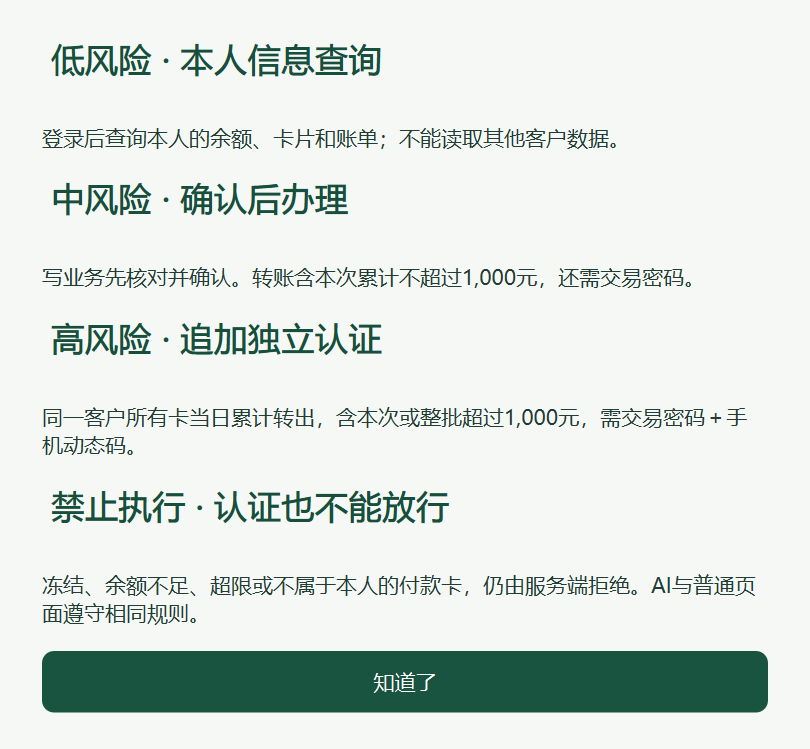
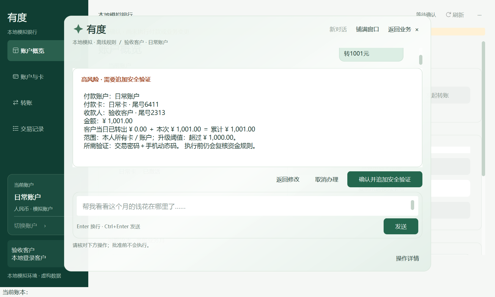
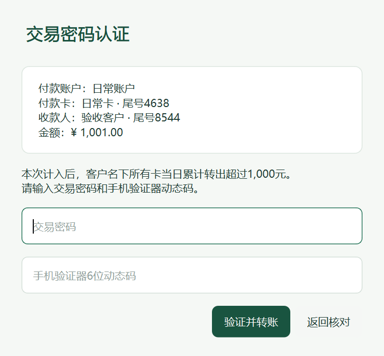

# 客户累计转账与手机验证器（2026-11-01，待审）

## 安全分级展示增量

用户明确安全分级是重点，扫码仅为认证方式。本轮沿用既有业务与MFA，未增加认证因素或模拟绕过入口：

- 右上“更多→安全分级说明”：低风险仅查本人数据；中风险写业务先确认，转账还需交易密码；客户所有卡当日累计含本次超过1000元时追加独立动态码；冻结、余额不足、超限或归属不符仍拒绝执行。
- 正式界面只对成功的纯查询显示“低风险 · 本人信息查询已完成”。转账确认显示中／高风险标题、真实付款对象与金额、客户当日累计等式、升级阈值及所需验证。普通表单和AI共用确认卡。金额是确认时快照，执行仍重查，说明本身不授予权限。
- 助手内确认、修改、取消按钮移到滚动说明区之外固定展示；返回业务页时回到原确认卡，不复制按钮或业务事件。大批量仍需滚动核对完整列表。
- 绑定窗口说明须用身份验证器“添加账户”扫码，不是微信或普通相机；认证机制未变化。

接口为兼容性新增：单笔和批量 `confirm.payload.risk_context` 包含 `scope=CUSTOMER_DAILY`、`daily_transfer_total_minor`、`current_amount_minor`、`projected_total_minor`、`threshold_minor`，金额均为整数分。批量仅在整批层提供累计，不把每笔显示为独立认证。由场景确认钩子查询服务端账本提供，客户端校验类型及等式；旧服务缺少该字段时不编造累计数字。请求、操作哈希、挑战、认证、执行与账本格式均不变；前端开发工作台可忽略新增字段。

复演：原EXE登录→右上查看安全分级→查询余额→准备一笔累计不超过1000元的转账（中风险、交易密码）→取消→准备含本次超过1000元的转账（高风险、累计原因、两项验证）→认证→查实际回执。不要为演示在日常账本随意付款。

实际测试使用独立临时账本：两名新注册客户，付款2000元、收款0元；原生窗口先查询余额，准备1000元显示中风险后取消，再准备1001元显示高风险，认证后付款999元、收款1001元。跨卡已转1000再转1的累计展示为1000+1=1001；批量按整批总额显示。125%为1200×800、150%为1200×720逻辑像素，操作按钮可见；截图不含凭据或绑定二维码。

验证分层：`test_customer_mfa.py` 核对真实SQLite/ASGI下的跨卡、临界值及批量金额；`test_desktop_mfa.py` 使用真实TCP HTTP和原生窗口、既有离线表达；`capture_assistant_space.py` 检查短确认内容和固定按钮不裁切、不重叠及收起重开后的同一操作。未新增真实模型或真人手机扫码验收，不据此声称生产安全或比赛认证。

最终门禁：`ef51f1c` 的 `scripts/check.ps1` 完整通过，870项Python（156.17秒）、46项Node及pip check；HTTP smoke通过。随后 `cd68769` 仅修正低风险查询提示在自动账户刷新后被覆盖的展示问题，追加原生认证/注册登录3项专项通过（12.18秒），未重复全套资金测试。EXE哈希与原账本绑定未变，日常数据未用于验收。

保留失败记录：初轮全量有1项旧确认字段集合断言失败，按新增契约补入risk_context；固定按钮后旧“按钮应在滚动区内”断言失效，改为检查按钮在面板内且不与滚动区重叠，并确实发现小窗口5像素重叠，调整操作区高度和待确认间距后专项通过。真实窗口首次查询后立即发下一请求遇到异步账户刷新，验收脚本补等刷新完成，未改资金业务。截图核对还发现风险文案较长挤掉确认按钮，最终固定操作区并保留说明滚动。

## 使用与结果

继续双击原 `Youdu.exe`，使用原注册账号和密码。右上“更多→绑定手机验证器”：重新输入登录密码，在独立手机的 TOTP 验证器中扫描二维码，输入6位动态码完成绑定。首次高风险转账未绑定时也会引导。绑定不会付款；绑定码已消费，需要等待下一组动态码，再核对原确认并输入交易密码和动态码。取消认证窗口只是返回核对；取消交易使用原“取消办理”。

本机 EXE、`Youdu.ledger-path` 与日常账本未修改。数据库只新增独立认证表，不改已有凭据、余额、卡号、流水或回执。已注册客户不用重新注册；历史无凭据客户仍不能认领。现有 EXE 调用项目源码，退出旧应用、重新双击即可使用本轮代码，不改入口、不自动换库。

同一客户名下**全部账户**当日成功 `TRANSFER_OUT` 总额，加本次单笔/批量总额，超过100000分为 RED；正好100000分为 YELLOW。本人卡之间转出也计入；入账、模拟入金、商户消费、失败或取消不计。业务日沿用现有账本时钟，动态码独立使用真实系统时间，不能拿演示业务日期生成动态码。执行事务中再次核对累计额；旧 YELLOW 确认不能绕过其他会话新增的累计额。

## 身份与认证契约

普通表单、自然语言准备均汇入既有 challenge / resume / 银行业务执行路径。风险由服务端账本计算，客户端不传 user_id 或“认证成功”。批量只核对整批、认证一次，资金仍整批原子提交。

| 接口 | 请求与返回 | 约束及调用方 |
|---|---|---|
| GET `/auth/me` | 新增 `mfa_configured: boolean` | 原登录会话；桌面认证前读取，其余字段不变 |
| POST `/auth/mfa/enroll` | `login_password` → `enrollment_id, uri, expires_in` | 原客户会话、重验登录密码；未绑定才允许；5分钟有效，不覆盖已绑定密钥 |
| POST `/auth/mfa/confirm` | `enrollment_id, code` → `status: CONFIGURED` | 会话归属、有效期及真实TOTP验证；失败不绑定 |
| POST `/agent/chat` 的 `resume` | 原 `challenge_id, decision, otp`，新增可选 `totp` | `otp` 在 LOCAL 模式仍是交易密码；RED 转账必须验证 `totp`，YELLOW 旧调用兼容 |
| `get_balance.data.daily_transfer_total_minor` | 字段名不变，改为所属客户全部账户累计 | 影响单笔/批量风险判定和执行复核；不再按当前账户单独累计 |

错误通过现有 JSON `code/message` 返回；`MFA_REQUIRED` 引导绑定，`MFA_INVALID` 提示错误/过期，`MFA_REPLAY` 等待下一组，`MFA_LOCKED` 提示15分钟锁定；不会写进模型上下文或展示内部异常。密码/动态码只进入专用掩码控件和认证请求。二维码只在本机内存生成，不向外站发送或保存到文件。桌面使用 `segno==1.6.6`，服务端使用 `pyotp==2.9.0`，不自行实现OTP算法。

新增 `local_mfa` 保存 Windows 当前用户 DPAPI 加密的密钥、待绑定状态、已用时间步和失败锁定计数；`local_mfa_grants` 仅保存客户/挑战/操作哈希/到期时间，用于同一操作认证已成功但响应中断时重试。原 SQLite 事务保证消费动态码与授权记录一起提交。未存动态码原文；匹配同一授权不意味着允许新付款。服务端还须检查挑战、会话和完整参数，修改任一项目重新确认和认证。

动态码30秒一组，允许前后各一个时间步的时钟偏差；已消费的时间步不能用于另一次付款。连续错误5次锁15分钟，状态跨重启和新转账保留；锁定到期后可重新尝试。绑定和付款共用这组动态码限制；登录密码和交易密码沿用各自限制。原模拟认证接口在正式登录模式仍关闭。

## 实际证据与限制

专项使用临时账本，不读写日常资金：

- 两个新客户：第一张卡转1000元为YELLOW；增开第二账户和卡，再转1元为RED，只有交易密码得到 `MFA_REQUIRED`。绑定并用下一组码后成功。付款方全部账户合计2099元，收款方1001元；重复确认余额不变。重建服务后原凭据、账本JSON、余额、卡和流水保留。
- 5次错误码锁定，取消后重启、新建另一笔也不能绕过；模拟墙钟推进15分钟后恢复。成功码不能用于另一笔；取消后的旧确认不能支付。无会话、跨客户绑定、过期绑定均拒绝。
- 并发会话先转500元：原600元YELLOW确认执行时得到 `REAUTHORIZATION_REQUIRED`，不多扣；新RED确认后冻结卡，即使两项认证通过也得到 `SOURCE_CARD_FROZEN`。
- 替身模型发起批量900+700元、余额1500元：认证后整批失败，无部分扣款；900+200元整批成功，付款400元、收款1100元，重发原确认回执相同。已有卡号不足余额用例补齐真实TOTP前置后继续验证资金拒绝，没有删旧断言。
- 原生PySide6 + 真实HTTP：注册两客户、开户办卡、明确模拟入金2000元、绑定、通过既有离线表达发起1001元转账并在认证窗口输入两项认证；结果付款999元、收款1001元。125%时1200×800、150%时1200×720逻辑像素（适配屏幕高度），绑定QR不越界。截图均在输入凭据前或支付完成后，不含二维码/密钥。

测试来源：`tests/test_customer_mfa.py`（ASGI HTTP、真实认证/DPAPI/SQLite、替身模型）；`tests/test_desktop_mfa.py`（真实TCP HTTP、原生窗口、离线规则）。自动验收中的动态码由运行时生成的测试验证器提供，**尚未人工拿手机扫码验证，也没有本轮真实大模型验收**。

最终代码 `281a739`：仓库 `scripts/check.ps1` 通过，870项Python（140.29秒）、46项Node、pip check；`scripts/smoke_api.py` 通过账单、追问、确认、转账、重放、余额与重置。首轮门禁输出长时间停在桌面测试区域时被主动中止，未作为通过证据；桌面组合专项5项通过、补齐新窗口测试清理后，完整重跑得到上述结果，没有声称已定位到产品卡死。敏感字段扫描只命中原教学说明/测试占位符，无新增真实凭据。认证行为、桌面接入分别记录在 `d72fcdf` 和 `281a739`，文档提交不再机械重跑业务测试。

保留失败记录：旧“高风险只输交易密码”两项用例初轮失败，按新契约绑定真实测试验证器后通过；初轮桌面用了离线规则不认识的表达，未生成确认，改用既有离线表达验证界面，未因此宣称自然语言泛化成功；批量替身模型失败后残留回答影响下一轮，测试清理脚本队列后复验。最初缩放参数叠加了系统125%，后依据实际DPR调整并重新截图。

当前仅Windows支持密钥保护，移库到其他Windows用户/电脑不承诺可解密，失败拒绝认证，不能降级。本轮不提供换绑、解绑、恢复码或遗失找回；不得仅凭登录密码重置第二因素。TOTP具备知识因素（交易密码）+独立手机持有因素，但不能抵御钓鱼或拥有本机执行权限的恶意程序，不宣称银行生产等级安全。聊天/挑战不跨重启恢复，重启后查实际流水/回执，不自动重付。下一任务是用户手机扫码联调以及独立评审恢复/换绑流程。
